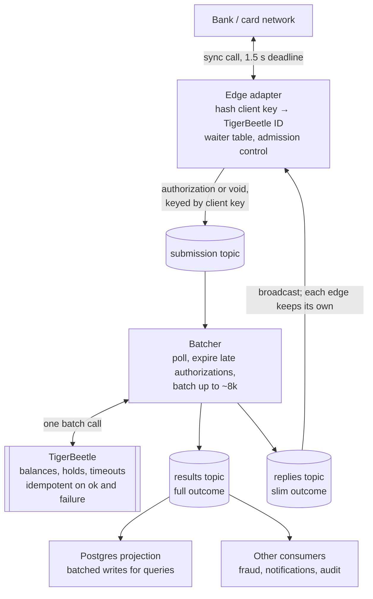

# High-Throughput Ledger Pipeline — Design Notes

*As of 2026-10-26 · Dumitru Nicolae Marasoiu*

A hobby design for a card-authorization ledger pipeline that sustains 200,000 transactions per second (TPS), stays correct under crash-stop failures, and is proven correct mainly by deterministic simulation and fault injection. It serves as the starting functional spec, non-functional spec and design for an implementation in Scala 3 with Cats Effect.

**Status markers used throughout:** *verified* = checked against the cited source; *estimate* = rough reasoning, to measure; *recollection* or *verify* = believed true, not yet checked.

---

## 1. Context and goals

- **Domain:** card-authorization-style debits. The issuer must answer within a hard deadline; holds (pending amounts) are later posted or voided.
- **Setting:** a hypothetical core-banking platform serving a large bank. Clients may be async-capable or may insist on a synchronous call.
- **Rate:** 200k TPS as an average over a 1-minute window, with 300k TPS as the stress scenario. Sub-second bursts of 2 to 3 times that are absorbed by queues (*estimate*).
- **Deadline:** the ledger answers within **1.5 s**, inside the bank's 2 to 3 s card-network budget. A "timed out" answer is acceptable and does not count toward SLA penalties.
- **Correctness bar:** no double debit, no lost result, a deterministic outcome for every request, and an explicit "timed out" reply that means no money stays held, even when any process crashes at any point. (A caller that loses its connection because the edge crashed gets no such guarantee; see section 12.)
- **Building blocks:** Kafka (logs), TigerBeetle (ledger and money invariants), Postgres (queryable projection, off the hot path).

## 2. Design philosophy

Each stage does one clear thing against one clear store, commits its progress, and hands over to the next stage through a log.

1. **One stage, one job, one store.** A failure or overload in one kind of operation does not swamp the others.
2. **Log intent before effect.** Every command is durable in Kafka before it touches the ledger, so every effect can be found and reconciled.
3. **Batch everywhere, idempotent per item.** Throughput comes from batches; safety comes from each item carrying its own idempotency ID.
4. **Nothing random on the path to an effect.** Every ID that reaches TigerBeetle is re-derivable from the request itself.
5. **Recovery is the normal path.** Replay after a crash runs the same code as normal processing.
6. **Keep headroom.** A store at its limit has no room for bursts, failover or a lagging consumer.
7. **Count the couplings.** Three systems at 99.99% each give about 99.97% combined; removing a system beats tuning one.
8. **Functional core, imperative shell.** Money logic is pure state machines; effects live in a thin shell. This is what makes deterministic simulation possible (section 11).

## 3. From 200k TPS to the architecture

The throughput target alone forces Postgres off the hot path and makes batching mandatory.

1. At 200k to 300k TPS, one-by-one processing is impossible at every stage, so **batching is mandatory**.
2. **TigerBeetle is not the bottleneck.** It processes batches of up to about 8,190 transfers, runs single-core with a single leader by design, ([Performance](https://docs.tigerbeetle.com/concepts/performance/)), and is believed to sustain roughly 100k to 500k TPS on one cluster (*recollection, verify*: the Performance page gives no TPS figure). At 200k TPS it runs nearer its ceiling than its makers recommend.
3. **A single Postgres writer** doing several writes per transaction is very likely over its comfortable limit (*estimate*).
4. If Postgres stayed on the hot path, CDC from its WAL would be the cheapest way out. But at the limit, CDC is fragile: a lagging consumer forces WAL retention, which can fill disk and stall the database.
5. **Conclusion:** demote Postgres to an async projection. Kafka is the durable intent log; TigerBeetle is the durable outcome and invariant enforcer.

## 4. Architecture: the river

Requests flow through Kafka topics and a single processing stage, the batcher; Postgres sits downstream, off the hot path.

- **Edge adapter:** accepts the call, derives the TigerBeetle ID by hashing the client key (section 7), registers a waiter, and writes the command to the submission topic.
- **Submission topic:** keyed by client key, so an authorization and its later void land on the same partition, in order.
- **Batcher:** polls a chunk, resolves authorizations past their core deadline as `expired` without calling TigerBeetle, submits the rest to TigerBeetle as one batch, then writes results, slim replies and the consumed offsets in one Kafka transaction. Voids are never expired: they are always submitted, however late.
- **Replies topic:** broadcast to every edge instance; each completes only its own waiters (section 9).

## 5. Correctness under crash-stop

Every crash point resolves to a replay that produces the same outcome.

| Crash point | What happens on replay | Rule that makes it safe |
| --- | --- | --- |
| Edge crashes before the command is in Kafka | Nothing happened; the caller sees a timeout | Nothing is executed until it is durable in the log |
| Edge crashes after writing to Kafka | The command is processed; nobody is waiting for the reply | Results are durable; the bank reconciles via the network's advices |
| Batcher crashes before calling TigerBeetle | The chunk is re-polled and submitted | Offsets are committed in the same transaction as the results |
| Batcher crashes after TigerBeetle, before writing results | Resubmission returns `exists` for successes and `id_already_failed` for transient failures | TigerBeetle idempotency covers both successes and rejections (*verified*, since 0.16.4) |
| The same client key arrives twice | The same hashed ID returns the original outcome | ID derived deterministically from the client key |
| A hold is abandoned | TigerBeetle voids it after its timeout and returns the funds | Every authorization is a pending transfer with a timeout |
| A reply is lost on the way to the client | It is a timeout from the caller's view; the ledger stays consistent | Deadlines plus the compensating void (section 8) |

**Consequences to design for:**

- On replay, the batcher learns *that* a transient rejection happened, but not necessarily the original reason (for example insufficient funds versus account not found). Persist the reason in the result before committing, or accept a generic reason on the rare replay path.
- `exists` must be treated exactly like `ok`, with the original result rebuilt by looking the transfer up.

## 6. Facts: verified versus assumed

| Claim | Status | Source |
| --- | --- | --- |
| Pending transfers can carry a timeout; on expiry the full amount returns | Verified | [Two-phase transfers](https://docs.tigerbeetle.com/coding/two-phase-transfers/) |
| Timeout is an interval in seconds from arrival at the primary | Verified | [Time](https://docs.tigerbeetle.com/coding/time/) |
| A transfer ID that failed with a transient error returns `id_already_failed` on retry; a new attempt needs a new ID | Verified, since 0.16.4 | [create_transfers](https://docs.tigerbeetle.com/reference/requests/create_transfers/) |
| `pending_transfer_not_found` is one of those transient errors | Verified | [create_transfers](https://docs.tigerbeetle.com/reference/requests/create_transfers/) |
| `pending_transfer_expired` is not transient | Verified | [create_transfers](https://docs.tigerbeetle.com/reference/requests/create_transfers/) |
| Events in one batch are applied in order, and a post or void may reference a pending transfer created earlier in the same batch | Recollection, verify | Not stated on the create_transfers page |
| `exists` should be handled exactly like `ok` for crash recovery | Verified | [create_transfers](https://docs.tigerbeetle.com/reference/requests/create_transfers/) |
| Batches of about 8,190 transfers; single core, single leader | Verified | [Performance](https://docs.tigerbeetle.com/concepts/performance/) |
| Random IDs give about 10% lower throughput than strictly increasing IDs | Verified | [Data modeling](https://docs.tigerbeetle.com/design/data-modeling/) |
| Java client is thread-safe; one shared instance batches concurrent events | Verified | [Java client](https://docs.tigerbeetle.com/coding/clients/java/) |
| Expiry voids may land a second or two after the timeout | Practitioner report | [Aivars Kalvāns](https://dev.to/aivarsk/running-tigerbeetle-without-a-control-plane-database-part-two-3c0p) |
| Card networks do not resend an authorization within a round; they apply stand-in and send an advice | Recollection, verify | Scheme specifications |
| Card-network authorization is synchronous on the hot path | Recollection, verify | Scheme specifications |

## 7. ID strategy

The mapping from a client key to a TigerBeetle ID sits behind one interface, so it can be swapped without touching the pipeline.

- **Chosen: hashing.** The ID is a 128-bit hash of client ID plus client key. It needs no store, is deterministic, survives replay, and lets the edge compute it before anything else happens.
- **Cost:** about 10% lower TigerBeetle throughput than strictly increasing IDs (*verified*). The likely mechanism (*inferred*): random keys make LSM files overlap, so compaction rewrites more and existence checks probe more levels.
- **Contract:** TigerBeetle remembers IDs forever, so client keys must be unique per client for all time. Do not scope the hash by calendar date, or a retry crossing midnight becomes a new transfer.
- **Retry contract:** once an ID fails with a transient error or is voided, it can never succeed again. (Validation errors are not recorded, so an ID rejected for those could succeed if resent with corrected fields; with hashed IDs and unchanged fields this does not arise.) A client retrying after a timeout either reuses the key and gets the original outcome, or uses a new key for a genuinely new attempt.
- **Void IDs:** each void gets its own fixed ID, the hash of the original transfer ID plus a "void" tag, so voids are idempotent too.
- **Winning back the ~10%:** switch to time-ordered IDs behind the same interface. Either clients supply ULIDs or TigerBeetle-style time-based IDs, or a mapping layer assigns one on first sight of each client key (a Kafka Streams stage with a state store, or DynamoDB with conditional puts). The mapping layer brings back a state store, restore time after failover, and roughly 1 to 2 TB of dedupe state per day at 200k TPS (*estimate*), which is why it is not the default.
- **Rejected:** IDs derived from Kafka partition and offset. They would need the offset of the key's first occurrence, which requires a state store anyway.

## 8. Deadlines, voids and failover

A "timed out" answer must mean that no hold survives.

**Deadlines**

- **No retries within a round** (*recollection, verify*): on an issuer timeout, the networks apply stand-in rules and later send an advice. The follow-up is a reversal, not a resend; merchant retries are usually new authorizations with new identifiers. So the timeout answer is final for that round.
- **Two deadlines:** each command carries a core deadline of about 1.2 s, stamped as absolute time at the edge. The batcher resolves authorizations past it as `expired` instead of calling TigerBeetle; voids are exempt. The edge deadline stays at 1.5 s; the gap covers post-TigerBeetle propagation.
- **Clocks:** the core deadline is stamped on one machine and checked on another. Normal clock synchronization keeps drift to milliseconds; this assumption is part of the design.
- **Normal-case budget** (*estimate*): about 150 to 400 ms, dominated by the batcher's transaction cadence and the edge's read-committed consumption of replies; under 100 ms when tuned. The risk is tail events, not the average.

**The compensating void**

When the edge times out, it writes a void command for that transfer ID. Three rules make the void safe:

1. **Same partition, same order.** The void goes to the submission topic keyed by the same client key as the authorization, through the same idempotent producer, so the log delivers it after the authorization. Until in-batch ordering is verified (section 6), the batcher never puts a void in the same TigerBeetle batch as its authorization. A void can never overtake the transfer it cancels.
2. **Fixed void ID.** The void's own ID is the hash of the transfer ID plus a "void" tag, so a replayed void is idempotent.
3. **Benign failure.** If the authorization was resolved as expired, the void returns `pending_transfer_not_found`: nothing was ever held. Because this is a transient error, the void ID is then permanently failed, which is exactly what we want. If the hold already timed out, the void returns `pending_transfer_expired`, which is equally benign.

Rule 1 is essential. A void sent out of band could reach TigerBeetle before the pending transfer, fail, and burn its ID, leaving the hold alive until its own timeout. **Anything that bypasses the per-key partition order, such as hedged submission through a second consumer group, breaks this guarantee.**

The pending transfer's own timeout remains the last backstop if a void is lost entirely.

**Failover**

- **Batcher state is small:** with hashed IDs the batcher keeps no dedupe store, so failover means reassigning partitions and resuming from committed offsets. There is no state to restore.
- **Remaining gap is failure detection,** typically seconds, governed by the session timeout. Partitions owned by a dead instance stall; their requests time out and are voided.
- **Why not 1 s detection:** pauses and network blips cause false evictions and rebalance storms; detection is only part of the outage; brokers enforce minimum session timeouts; heartbeat traffic grows. Correctness would survive anyway, thanks to transactional fencing and TigerBeetle idempotency.
- **Partition count is a blast-radius setting:** more partitions per instance means each failure touches a smaller slice of traffic.
- **Deferred: hedged submission.** A second consumer group submitting requests still unanswered after about 300 ms would remove the failover stall, but it breaks per-key ordering for voids (above) and can double TigerBeetle load. Revisit only with a design that keeps voids ordered.

## 9. Reply routing

Start with broadcast over a slim replies topic; switch to reply addressing only if the edge fleet grows past about 50 instances.

- **The problem:** the client key decides where work is processed, but the load balancer decides which edge instance holds the TCP or QUIC connection. The result must cross from one mapping to the other.
- **Best-effort by design:** results are durable, and deadlines plus voids keep the ledger consistent. A lost reply is a timeout, not a correctness failure.
- **Edge waiter table:** an in-memory map from request ID to waiting connection, each entry expiring at the deadline. The whole fleet holds at most about 300k entries at 200k TPS and 1.5 s.
- **Chosen: broadcast.** Every edge instance reads the slim replies topic (request ID, outcome code, amount) and completes only its own waiters. The request ID sits in the record key or a header, so non-matching records are skipped without parsing.
- **Cost model:** broker egress = N instances × 200k/s × message size. At about 50 B per reply, that is about 10 MB/s per instance and about 1 GB/s for 100 instances. The lookup costs tens of nanoseconds; consumer work is an estimated fraction of a core per instance.
- **Upgrade path:** the edge stamps a reply address on each request, and a dispatcher forwards results to a per-instance replies partition (stable instance identity, such as a StatefulSet ordinal) or by direct RPC. The switch does not touch the core pipeline.
- **Rejected:** moving the connection to the partition owner. The edge would have to track Kafka assignments through every rebalance.
- **Failures stay benign:** a dead edge instance takes its connections with it, so its replies are discarded; a lagging consumer delivers late replies that are dropped.

## 10. Implementation notes (Scala 3 + Cats Effect)

The shell uses Cats Effect and fs2 around a pure Scala core; Kyo was considered and set aside.

- **Why Cats Effect over Kyo:** fs2-kafka is the most mature Kafka streaming library in Scala; TestControl is the closest the JVM has to a deterministic scheduler; http4s or Ember, Skunk or Doobie, and otel4s share one runtime. Kyo has no native Kafka client, and bridging fs2 through kyo-cats would mean two runtimes and a seam for cancellation and backpressure.
- **Trade-off accepted:** coarser effect typing (mostly `IO`, errors as `Throwable`). Precise typing lives in the pure core as domain types: commands, outcomes, rejection reasons.
- **Stack:** fs2-kafka for producers and consumers; http4s or Ember at the edge; Skunk or Doobie for the Postgres projection; otel4s for tracing.
- **TigerBeetle client:** a thread-safe Java wrapper over the native client, which runs its own internal I/O thread. Use one shared instance per process. Wrap `createTransfersAsync` (a `CompletableFuture`) with `IO.fromCompletableFuture`; never block on the completion callback.
- **TestControl caveat:** it is deterministic only for pure `IO`. Real fs2-kafka uses the Kafka client's own threads, so TestControl applies to shell tests against simulated ports, not against real Kafka.

## 11. Testing strategy

Testing is the centerpiece of the project: every invariant is checked by deterministic simulation first, then by fault injection against real binaries.

| Layer | What runs | Faults | Reproducible | Catches |
| --- | --- | --- | --- | --- |
| 1. Deterministic simulation (DST) | Pure core plus simulated Kafka, TigerBeetle, clock and network in one thread | Crash between any two steps, redelivery, duplicates, rebalances, lag, lost replies, slow partitions, overload | Yes, by seed | Interleaving and recovery bugs in pipeline logic |
| 2. Contract tests | The same small suite against simulators and real Kafka and TigerBeetle | None; semantics only | Yes | Simulators drifting from real behavior |
| 3. Shell tests (TestControl) | Cats Effect shell against simulated ports | Timeouts, cancellation, scheduling order | Mostly, by seed | Wiring bugs in the shell |
| 4. Network perturbation (Toxiproxy) | Real binaries in Docker Compose or CI | Latency, jitter, bandwidth limits, resets, half-open connections | Partly, by scripted scenario | Timeouts, retry storms, deadline handling |
| 5. Cluster chaos (Chaos Mesh or LitmusChaos) | Real deployment in a staging cluster | Pod and node kills, partitions, I/O delay, CPU pressure, clock skew | No | Failover and rebalance behavior at scale |
| 6. Optional: Antithesis | Real containers in a deterministic hypervisor | Generated faults across the whole system | Yes | Black-box bugs DST cannot model |

**Invariants checked in every layer:**

- No transfer is applied twice.
- Every request reaches exactly one terminal outcome.
- Once the edge has replied "timed out" and the batcher has processed its partition up to that request's void, no hold for that request survives.
- Whenever the edge replied with an outcome, it matches the ledger.
- Balances never break their configured limits.
- Under overload, useful throughput stays above a floor instead of collapsing to zero.

**Core as pure state machines.** No JVM effect runtime is fully plug-and-play for DST: Kyo lacks a deterministic scheduler, and Cats Effect TestControl breaks on outside threads. So the money logic is a functional core with an imperative shell, as FoundationDB and TigerBeetle do.

- **Functional core:** each component (edge waiter and admission logic, batcher, deadline and void rules) is a function from state plus event to new state plus commands. Events include request arrived, batch result returned, time advanced, consumer rebalanced.
- **Two interpreters for the commands:** the Cats Effect shell performs them for real; the simulator performs them in a deterministic event loop.
- **Simulator:** a plain loop over a priority queue of events ordered by simulated time, with a seeded random generator choosing delays, reorderings and crashes. No fibers involved.
- **Simulated adapters model real semantics,** not canned mock answers: offsets, commits, redelivery and rebalances for Kafka; `exists`, `id_already_failed`, `pending_transfer_not_found`, balance limits and pending timeouts on the simulated clock for TigerBeetle.
- **Reference design worth studying:** Haskell's [io-sim](https://hackage.haskell.org/package/io-sim), which runs the same code under real IO or a simulator with schedule exploration.

**Fault tools compared:**

- **Toxiproxy:** a programmable TCP proxy between processes. Free, lightweight and scriptable from tests; fits laptops and CI. It only perturbs connections; it cannot kill processes or skew clocks.
- **Chaos Mesh and LitmusChaos:** open-source, Kubernetes-native; experiments are cluster resources covering pod kills, partitions, I/O faults and stress. Suited to scheduled staging runs.
- **Gremlin:** commercial, with managed safety controls; aimed at enterprises and production.
- **Antithesis:** commercial deterministic testing for real containers, with no simulators to write.

**Suggested order:** DST and contract tests from day one, then Toxiproxy in CI, then Chaos Mesh in a staging cluster once there is a real deployment.

## 12. Known gaps

These are open in the functional and non-functional spec.

1. **Overload and admission control.** With hard deadlines, a backlog makes every queued request expire, and useful throughput drops toward zero while the system looks busy. The edge must decline fast once lag or the in-flight count crosses a threshold; the batcher's cheap expiry of late authorizations is the second line of defense.
2. **What an authorization checks.** TigerBeetle enforces balances. Card status, limits, currency and blocked accounts are unspecified, as is whether they run before TigerBeetle or are encoded as TigerBeetle accounts and limits.
3. **The rest of the card lifecycle.** Capture (including partial captures), incremental authorizations, reversals, and stand-in advices that force a post or void after the fact.
4. **Silent TigerBeetle events.** Auto-expired holds produce no Kafka record. Downstream views need TigerBeetle change data capture or a periodic scan by timestamp (*verify current CDC options*).
5. **Observability.** Per-stage latency, consumer lag, timeout rate and void rate from day one.

**Follow-ups from review** (need discussion or deeper analysis):

6. **Orphaned holds after an edge crash.** If the edge crashes after writing an authorization, the caller sees a dropped connection, and the hold stays until a network reversal advice or its own timeout. Decide whether that is acceptable, or whether something else must void requests whose edge died (for example a sweeper keyed on edge instance liveness).
7. **Producer ordering under failure.** Rule 1 of the compensating void relies on one idempotent producer sending both the authorization and the void. If the authorization's send outcome is unknown, or the producer is recreated between the two sends, the order is no longer guaranteed. Define what the edge does in those cases: wait for the authorization's ack before writing the void, or treat an unacknowledged authorization differently.
8. **Same client key, different payload.** A retry that reuses a key with a different amount or account gets TigerBeetle's `exists_with_different_*` errors rather than the original outcome. Define the client-facing response and whether the edge should catch it earlier.
9. **Batch splitting cost.** Keeping a void out of its authorization's batch (rule 1) is cheap in the normal case, but measure it under bursts where many voids follow their authorizations closely.

## 13. Alternatives considered

| Alternative | Why not chosen |
| --- | --- |
| Postgres as hub, CDC to TigerBeetle and back (original design) | Single writer near its limit; CDC slot lag can stall the database |
| Sync HTTP: write Postgres, call TigerBeetle, write result, reply | Fine at about 20k TPS, but needs a separate, rarely exercised crash sweeper |
| DynamoDB idempotency map, then TigerBeetle, then Kafka | A third system on the hot path; an ordering gap if Kafka is written after TigerBeetle; high cost at peak |
| Kafka Streams stage assigning time-ordered IDs | State store, restore time and dedupe-window sizing; kept only as the way to win back TigerBeetle's ~10% |
| Redis as idempotency map | Weaker durability for a correctness-critical mapping |
| Postgres LISTEN/NOTIFY to wake waiting requests | NOTIFY adds commit contention at high throughput |
| Reply addressing (per-instance partitions or direct RPC) | Not needed below about 50 edge instances; kept as the upgrade path from broadcast |
| Hedged submission via a second consumer group | Breaks per-key ordering for voids; deferred |
| Kyo instead of Cats Effect for the shell | No native Kafka client; fs2 bridging means two runtimes |

Below about 20k TPS, the simple sync path plus a sweeper is less machinery and probably the better choice.

## 14. Development stages

Each stage checks the assumptions the next one builds on: the simulator encodes TigerBeetle and Kafka behavior, so that behavior is checked against the real systems first. Work is tracked as one [GitHub milestone](https://github.com/nmarasoiu/dst-200ktps-ledger/milestones) per stage, with issues under each.

| Stage | Goal | Done when |
| --- | --- | --- |
| 0. Fact spike | Throwaway scripts against single-node TigerBeetle and local Kafka: in-batch ordering, same-batch `pending_id`, error codes, pending timeouts, transactional ordering of an authorization and its void | Every TigerBeetle and Kafka fact in section 6 is verified or refuted |
| 1. Spec as code | Domain types (commands, outcomes, rejection reasons) and the invariants of section 11 as predicates over an event history; scope is authorization and void only | Invariants compile and fail on hand-written bad histories |
| 2. Pure core | State machines for the batcher, edge waiter and admission control, deadlines and voids; no effects | Property tests pass per machine |
| 3. Deterministic simulator | Seeded event loop with simulated Kafka and TigerBeetle that behave as stage 0 found | Millions of seeds pass, failures replay by seed, and planted bugs are caught |
| 4. Contract tests | One suite run against both the simulators and the real binaries | Green on both in CI |
| 5. Cats Effect shell | fs2-kafka, the TigerBeetle client wrapped in `IO`, the http4s edge; TestControl shell tests | End to end on a laptop at low rate, surviving manual kills of any process |
| 6. Offline checker and Toxiproxy | A tool that reads the topics and TigerBeetle after a run and checks the same invariants; network fault scenarios in CI | Scripted network faults pass the checker |
| 7. Performance | Load generator stepping 20k, 100k, 200k and 300k TPS; per-stage latency, broadcast egress, partition counts, admission control under real load | 200k TPS with p99 inside 1.5 s, or a known ceiling and its cause |
| 8. Cluster chaos | Chaos Mesh in a Kubernetes staging cluster; Antithesis optional | The checker stays green across scheduled chaos runs |

- **One set of invariants for every stage.** They are defined once in stage 1 and checked by the simulator, the contract tests, the offline checker and the chaos runs.
- **Modules mirror the stages:** `core` (no dependencies), `sim`, `checker`, `shell`, `contract-tests`, `loadgen`. The compiler keeps the core free of effects.
- **A simulator that never fails proves nothing.** Stage 3 includes planted bugs, such as expiring a void or letting a void overtake its authorization, and the simulator must catch them.
- **Stages 2 to 4 are the heart of the project.** A walking skeleton on real binaries before stage 5 would mostly repeat stage 0.
