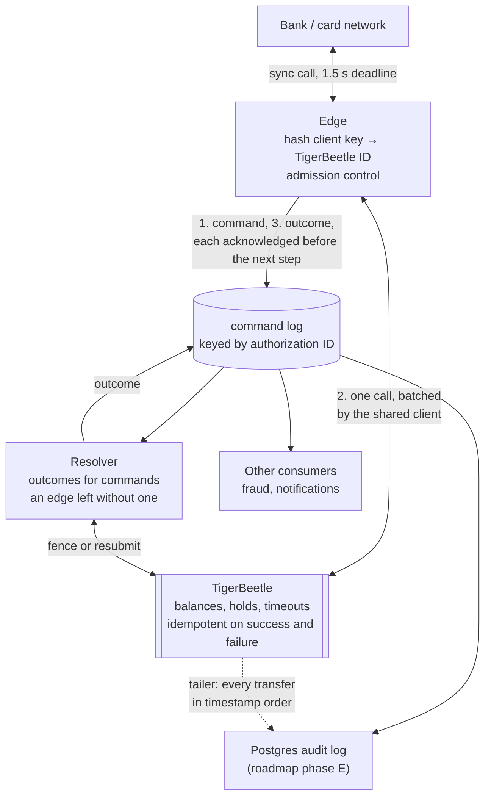

# High-Throughput Ledger Pipeline — Design Notes

*As of 2026-10-28 · Dumitru Nicolae Marasoiu*

A hobby design for a card-authorization ledger pipeline that sustains 50,000 transactions per second (TPS), stays correct under crash-stop failures, and is proven correct mainly by deterministic simulation and fault injection. It serves as the starting functional spec, non-functional spec and design for an implementation in Scala 3 with Cats Effect.

**Also in this repo:** [DESIGN-LOG.md](DESIGN-LOG.md) records every decision that was corrected and how the flaw was found; [ROADMAP.md](ROADMAP.md) lists the phases beyond the core. [CLAUDE.md](CLAUDE.md) holds the conventions for anyone, human or agent, editing the repo.

**TigerBeetle in one place:** [section 16](#16-how-the-design-uses-tigerbeetle) lists what the design relies on, what it works around, and questions for the TigerBeetle team.

**Status markers used throughout:** *verified* = checked against the cited source; *estimate* = rough reasoning, to measure; *recollection* or *verify* = believed true, not yet checked.

---

## 1. Context and goals

- **Domain:** card-authorization-style debits. The issuer must answer within a hard deadline; holds (pending amounts) are later posted or voided.
- **Setting:** a hypothetical core-banking platform serving a large bank. Each deployment serves one client, the bank; another client gets its own deployment. The bank's caller systems may be async-capable or may insist on a synchronous call.
- **Rate:** 50k TPS as an average over a 1-minute window, with 75k TPS as the stress scenario. Sub-second bursts of 2 to 3 times that are absorbed by larger ledger batches and by admission control (*estimate*). Each authorization costs TigerBeetle about two events over its life, so 50k TPS means about 100k TigerBeetle events per second (section 3). The daily average sets how fast storage grows, not throughput; the design assumes 10k TPS, a fifth of the peak (*estimate*, to replace with the bank's figure).
- **Deadline:** the ledger answers within **1.5 s**, inside the bank's 2 to 3 s card-network budget. A "timed out" answer is acceptable and does not count toward SLA penalties.
- **Correctness bar:** no double debit, no lost result, a deterministic outcome for every request, and safe cancellation of any request the caller got no definitive answer for, so that a "timed out" reply never leaves money held, even when any process crashes at any point.
- **Building blocks:** Kafka (the replicated command log, kept 30 days), TigerBeetle (ledger and money invariants, one cluster per period, section 4), Aurora PostgreSQL (the complete audit log and the long-term record, including the money movements of every retired cluster, off the hot path; [ROADMAP](ROADMAP.md) phase E).
- **Rules:** EU. The anti-money-laundering regulation keeps transaction records for 5 years after the customer relationship ends, or after an occasional transaction, then deletes their personal data; authorities may require up to 5 more years (section 6). The Postgres audit log keeps them (section 4, three records).

## 2. Design philosophy

Each component does one job against one store. Only the edge, the command log and TigerBeetle stand between a request and its answer; everything else reads a durable source at its own pace and keeps its own position in it.

1. **One component, one job, one store.** A failure or overload in one kind of operation does not swamp the others, and nothing downstream can slow the path to an answer.
2. **Log intent before effect, and outcome before answer.** Every command is durable in the replicated command log before it touches the ledger, and every decision is durable there before the caller hears it. Only the edge and the resolver write to TigerBeetle, and every effect follows a logged command, so the log records everything the ledger did, apart from expiries, which follow from what it records (section 12, gap 4).
3. **Batch everywhere, idempotent per item.** Throughput comes from batches; safety comes from each item carrying its own idempotency ID.
4. **Nothing random on the path to an effect.** Every ID that reaches TigerBeetle is re-derivable from the request itself, and every decision the resolver could make differently from the edge, such as expiry by the clock, is written to the ledger instead (section 8).
5. **Recovery uses the normal rules.** The resolver finishes what a crashed edge left unfinished with the same pure rules the edge uses. It is a second path that rarely runs in production, so the simulator crashes edges between every pair of steps, which makes it run constantly where it is tested.
6. **Keep headroom.** A store at its limit has no room for bursts, failover or a lagging consumer.
7. **Count the couplings.** Three systems at 99.99% each give about 99.97% combined; removing a system beats tuning one.
8. **Functional core, imperative shell.** Money logic is pure state machines; effects live in a thin shell. This is what makes deterministic simulation possible (section 11).

## 3. From 50k TPS to the architecture

The throughput target alone forces Postgres off the hot path and makes batching mandatory.

1. At 50k to 75k TPS, one-by-one processing is impractical at every stage, so **batching is mandatory**. It needs no queue: the TigerBeetle client and the Kafka producer each pack whatever arrives while their previous request is in flight (section 6).
2. **TigerBeetle is assumed not to be the bottleneck, and is not measured on its own.** It processes batches of up to 8,189 transfers and runs single-core with a single leader by design ([Performance](https://docs.tigerbeetle.com/concepts/performance/)). Each authorization costs it about two events over its life: the hold, then its capture, void or expiry; a cancel costs two, its fence and its void. Captures are not on the clock, so they could be held back during peaks (*estimate*). At 50k TPS that is about 100k events per second, and about 150k under stress. TigerBeetle's homepage claims 100k to 500k TPS ([tigerbeetle.com](https://tigerbeetle.com/)), though its docs give no figure, and one third-party cloud benchmark leveled off near 107k TPS on three 4-vCPU replicas with hot accounts, with its batching and ID order unstated ([SoftwareMill](https://softwaremill.com/tigetbeetle-vs-postgresql-performance-benchmark-harness-cloud-tests)). So the load sits at the low end of the claimed range, and the headroom depends on hardware. Each edge process sends its own batches, which grow with load (section 12, gap 9). Stage 7 measures the whole pipeline; if TigerBeetle turns out to be its ceiling, sharding ([ROADMAP](ROADMAP.md) phase B) moves into the core.
3. **A single Postgres writer** doing several writes per transaction, 150k to 250k row writes per second at 50k TPS, is likely near or past its comfortable limit (*estimate*).
4. If Postgres stayed on the hot path, CDC from its WAL would be the cheapest way out. But at the limit, CDC is fragile: a lagging consumer forces WAL retention, which can fill disk and stall the database.
5. **Conclusion:** keep Postgres off the hot path, as the audit log. Kafka is the durable log of commands and answers; TigerBeetle is the durable outcome and invariant enforcer.

## 4. Architecture: the logged direct path

The edge that holds the caller's connection logs the command, calls TigerBeetle, logs the outcome and answers. A resolver gives an outcome to every command an edge left without one. Postgres sits downstream, off the hot path.

- **Edge:** accepts an authorization, a `cancel(clientKey)` or a `capture(clientKey, amount)`, and derives the TigerBeetle ID from the client key (section 7). It writes the command to the command log and waits until the in-sync replicas acknowledge it, then calls TigerBeetle through the client it shares with every request in its process, writes the outcome and waits for that acknowledgement too, and only then answers. Each step continues from the last, so no thread waits (section 10). Without an acknowledged command the edge never calls TigerBeetle; without an acknowledged outcome it gives the same answer as on a timeout. A ledger result that arrives after the deadline is still logged, though the caller has already been answered, so the resolver needs no fence for it; the edge waits a bounded time for it, then leaves the command to the resolver.
- **Command log:** one Kafka topic holding every command and every outcome, keyed by the authorization's transfer ID, so each hold's whole story sits on one partition, in the order it was written. Replication factor 3 with `min.insync.replicas` 2, so an acknowledged record is on at least two machines (section 6). It keeps records for 30 days; the long-term record is the audit log (three records, below).
- **Resolver:** reads the command log and gives an outcome to every command still without one a grace period after its deadline, measured in the log's own time rather than by its clock. An authorization gets the fence; a cancel or a capture is resubmitted (section 8, resolver). It compares nothing: reconciling the log against the ledger is the offline checker's job, and later the audit log's. It is TigerBeetle's only other writer, and it never submits an authorization. It commits offsets only up to its oldest command still without an outcome.
- **No replies topic:** the process that holds the caller's connection makes the TigerBeetle call, so it answers directly. If it crashes, the connection goes with it and no answer is owed; the caller sees an error and cancels (section 9).
- **Downstream:** consumers read the command log. The Postgres audit log ([ROADMAP](ROADMAP.md) phase E) also reads TigerBeetle through the tailer, which returns every transfer in timestamp order (section 12, gap 4). Until then, the offline checker reads TigerBeetle with the same query once after each run.

**Three keys, three jobs.** Idempotency is per command; routing is per hold.

| Key | Identifies | Authorization | Cancel | Capture |
| --- | --- | --- | --- | --- |
| Client idempotency key | The client's request | `clientKey` | The same `clientKey` | The same `clientKey` |
| TigerBeetle transfer ID | One ledger command; TigerBeetle deduplicates on it | `A = id(clientKey)` | Fence `A` (same ID, no flags) and void `V = id(A, "void")` | Post `P = id(A, "post")` |
| Kafka record key | The hold the command concerns; only picks the partition | `A` | `A` | `A` |

Every later command about a hold (cancel, capture, reversal) carries `A`, so the partitioner routes every command on `A`. Kafka does not deduplicate on the record key, so two records sharing it are simply two records on one partition, in order. Keying by account would order every operation on an account for no benefit, since TigerBeetle already enforces balances, and would turn busy accounts into hot partitions.

**Command log rules:**

- **`cleanup.policy=delete`, never `compact`.** Compaction keeps only the latest record per key, so a cancel or an outcome would erase its authorization from the log, breaking principle 2.
- **Partition count fixed for the topic's life.** The default partitioner maps a key to `hash(key) mod N`; changing N scatters one hold's commands across partitions. Fenced cancels (section 8) keep that correct, but it defeats per-hold locality. Resizing means a new topic and draining the old one, so choose N with headroom.
- **`message.timestamp.type=LogAppendTime`.** The partition leader stamps each record with the time it appended it, and the resolver measures its grace period in these times (section 8, resolver).
- **`retention.ms` of 30 days, and no `retention.bytes` limit.** Records leave the log only by age. The 30 days cover the audit loader's worst outage plus the age of the oldest Postgres backup worth restoring (*estimate*), and the loader's lag raises an alarm long before. Kafka's default is 7 days (section 6).
- **The resolver never skips to the end of the log.** It uses `auto.offset.reset=none`, which is fs2-kafka's default, so a committed offset that is missing or has aged out of the log stops it with an error. Kafka's own default, `latest`, would silently skip every command still without an outcome (section 6). On first deployment an operator seeds its offsets at the start of the topic. The brokers keep committed offsets for at least 30 days, since by default an empty group's offsets expire after 7.

**Three records, three jobs.** Each store keeps one kind of record, for as long as it is needed.

| Store | Keeps | For how long | Clock for periods |
| --- | --- | --- | --- |
| TigerBeetle | Every transfer of its period: holds, posts, voids and fences | Until its holds end and the audit log has held all of it for 30 days (one cluster per period, below) | Its timestamp, which only grows within a cluster (section 6) |
| Command log | Every command and its decision, declines and their reasons included: what each caller was told, durable before the answer | 30 days | The command's append time |
| Audit log in Aurora PostgreSQL | Both, joined and queryable; the only record of a retired cluster's money movements | As long as EU rules require (section 1): about a year in Aurora, then an archive (*estimate*, [ROADMAP](ROADMAP.md) phase E) | Both, side by side |

- **Kafka is transport.** The record exists before the answer because the edge waits for the in-sync replicas' acknowledgement, not because Kafka keeps it for long. The audit log's lag changes when a period's report can run, never what it holds: a period closes only once the audit log holds everything in it, and reports read only closed periods ([ROADMAP](ROADMAP.md) phase E).
- **Money by the ledger's clock.** A money movement belongs to the period of its TigerBeetle timestamp; a command and its decision belong to the period of the command's append time. Near midnight the two can fall on different sides, and the audit log keeps both times.
- **Rebuilding the audit log.** Postgres is restored from a backup younger than 30 days and replayed from the positions stored with its rows, so a lost or damaged audit log loses nothing. A TigerBeetle cluster retires only once the audit log has held all of it for 30 days, so every backup young enough to rebuild from holds it too.
- **Until phase E,** nothing keeps commands and decisions beyond 30 days, and no cluster can retire. That is acceptable only before production.

**One TigerBeetle cluster per period.** One cluster cannot hold the ledger for its whole life.

- **Why.** A replica's data file is capped at 16 TiB by default and 64 TiB at most, a replica exits rather than pass the cap, and no operation deletes a transfer (section 6). A transfer takes about 300 bytes with its index entries, so an authorization takes about 600 bytes over its life (*estimate*). At the assumed daily average of 10k TPS (section 1) that is about 0.5 TB a day, so 16 TiB lasts about 5 weeks and 64 TiB about 4.5 months (*estimate*).
- **Two ways past the cap.** TigerBeetle has shown its older LSM levels tiered to object storage, which it calls diagonal scaling, but no release has it (section 6). Until one does, and a new time-ordered ID is shown to be checked without reading object storage, the ledger runs one cluster per period. Both ways need time-ordered IDs, which section 7 fixes now.
- **The key names the cluster.** Periods follow a schedule fixed in advance, like the ID layout. A hold lives in the cluster of the period that contains its key's creation time (section 7), so a cancel or a capture finds it from the key alone. A lookup could not do this safely: a cancel can arrive before its authorization is visible, and a fence written to the wrong cluster reports `cancelled` while the hold survives in the other.
- **A period's life.** Its cluster takes authorizations until the period ends. It takes cancels, captures and fences until its holds end: the 7-day hold timeout plus a margin, about 2 weeks (*estimate*). It retires once the audit log has held all of it for 30 days (rebuilding, above). So two or three clusters are live at a time, and only the newest grows fast.
- **An authorization after its period has ended** is treated as the resolver treats a straggler: the edge fences `A` in its period's cluster. `exists_with_different_flags` means an earlier copy created the hold, and the edge answers approved; `id_already_failed` means declined; `created` or `exists` means `A` is now fenced, and the edge answers declined, `not_executed`. Edges decide that a period has ended by their own clocks, and the fence keeps two edges that disagree consistent, as it does for the resolver (section 8, clocks). Only keys made moments before a switch, or by a caller whose clock is behind, take this path: a few hundred authorizations per switch at peak (*estimate*).
- **An authorization whose key's period has not started** by the edge's clock is refused. Nothing is sent, so the refusal is safe whatever the clocks, and the caller resends with the same key (section 5).
- **A key older than every live cluster** is answered from the audit log, with no ledger call. An authorization gets the decision recorded for its key, or is declined if there is none; a cancel or a capture finds that its hold ended long ago. This is the only read of the audit log made for a caller, so the audit log never sits on the path to a normal answer (section 13).
- **Open:** how each account's balance reaches the new cluster at a switch while the old cluster's holds drain (section 12, gap 10). Until that is solved, one cluster runs until its data file is full, which is acceptable only before production.

## 5. Correctness under crash-stop

Every crash point resolves to one decision, whether the edge records it or the resolver does.

| Crash point | What happens | Rule that makes it safe |
| --- | --- | --- |
| Edge crashes before the command is acknowledged | Nothing was sent to TigerBeetle; the caller sees an error and cancels. If the command landed anyway, the resolver fences it and records `not_executed` | The edge calls TigerBeetle only after the command is acknowledged, and only the edge submits an authorization |
| Edge crashes after the command is acknowledged, before or after calling TigerBeetle | The caller gets no answer and cancels. The resolver fences `A`: `exists_with_different_flags` means the authorization was created, recorded approved; `id_already_failed` means it was declined, with the reason unknown; `created` or `exists` means it never happened and never will | Expiry is a ledger write, not a clock reading (section 8) |
| Edge crashes after the outcome is acknowledged, before answering | The caller cancels. The logged outcome stands, and the cancel voids an approved hold | The caller's cancel contract (section 8) |
| An edge pauses past its deadline, and the resolver fences `A` before the paused edge calls TigerBeetle | The edge gets `exists_with_different_flags` and records `not_executed`, as the resolver did. If the edge got there first, the fence finds the authorization and both record approved | The fence. TigerBeetle orders the two calls, so both record the same decision |
| A write to the command log times out, though the broker may have written it | For a command, the edge does not call TigerBeetle and refuses the request; if the command landed, the resolver fences it. For an outcome, the edge answers as on a timeout, and the caller cancels | No ledger call without an acknowledged command; no decision answered without an acknowledged outcome |
| The resolver crashes | It reads again from its committed offset. It judges a command only after reading past where the command's outcome would be, so it acts again only on commands that still have none; fences and resubmissions are idempotent | Offsets never pass a command still without an outcome, and stragglers are judged in log time (section 8, resolver) |
| A zombie resolver, paused and then replaced by a rebalance, acts on a command its successor already resolved | Its fence or resubmission meets what TigerBeetle already decided, so it records the same decision as a duplicate, and the group coordinator rejects its offset commit (section 6) | TigerBeetle idempotency and the fence |
| A cancel overtakes its authorization, for example a stale send from a crashed edge | The fence creates `A`; the late authorization gets `exists_with_different_flags` and is reported `not_executed` | The authorization ID doubles as a fencing token (section 8) |
| The same client key arrives twice | The same hashed ID returns the original outcome. Callers resend an authorization only after a refusal, never after a non-definitive result, so a duplicate is a resend after a refusal, a stale send from an edge or a redelivery; one that lands after its cancel is reported approved, and consumers ignore it | ID derived deterministically from the client key; a cancel is never overridden (section 8) |
| A hold is abandoned | TigerBeetle voids it after its timeout and returns the funds | Every authorization is a pending transfer with a timeout |
| A reply is lost on the way to the client | It is a timeout from the caller's view, so the caller cancels | The caller's cancel contract (section 8) |
| A capture is sent | It can only follow an "approved" answer, which the edge gives only after TigerBeetle created `A`, so it never overtakes its authorization | The edge answers only after the TigerBeetle call returns and the outcome is acknowledged |
| A capture's reply is lost, or the edge times out on it | The caller resends the capture with the same key; a created post returns `exists` and the same amount is reported. The edge never cancels on a capture timeout | One fixed post ID per hold, and TigerBeetle posts a hold at most once (section 8, captures) |
| An authorization's command is acknowledged too late to leave time for the ledger call and the outcome write | The edge refuses the request and never calls TigerBeetle. The resolver later fences the logged command and records `not_executed` | A refusal is definitive until the edge hands the authorization to the TigerBeetle client (refusals, below) |
| A refused authorization is resent with the same key | If no copy reached TigerBeetle, the resend is the first real attempt. If an earlier copy did, the resend finds it, as `exists` or `id_already_failed`, and the caller hears that copy's decision. If the resolver has already fenced the refused command, the resend gets `exists_with_different_flags` and is declined `not_executed` | A refusal speaks only for the copy it refused, and the same key finds any copy that reached TigerBeetle (resending a refusal, below) |

**Consequences to design for:**

- **Refusals.** The edge may refuse an authorization at any point before it hands it to the TigerBeetle client: for overload (section 12, gap 1), because its log partition has no leader, because the log did not acknowledge the command, or because the acknowledgement came too late to leave time for the ledger call and the outcome write (section 8, deadlines). A refusal is definitive for the copy it refuses: only the edge submits an authorization, and it never sent this one. If the command was logged, or lands later, the resolver fences it and records `not_executed`. The hand-off is the last moment to refuse, because the client cannot take an event back (section 6).
- **Resending a refusal.** The caller may resend a refused authorization with the same key, as after an HTTP 503; the last row of the table above shows what the resend finds. When the resolver has already fenced the refused command, the resend is declined: a needless decline, but no money is held. A new key means a new request, never a resend: it would miss an earlier copy and could hold the money twice.
- **No hidden resends.** A refusal speaks for the key only if every copy of the request is one the caller sent. So no hop between the caller and the edge, such as an HTTP client library, a proxy, a load balancer or a service mesh, may retry an authorization or send a second copy of it on its own. Otherwise a copy whose answer was lost can create the hold while a retried copy is refused: the caller hears only the refusal, never cancels, and the money stays held until the hold times out. Whether such hops retry a request by default depends on the product and its configuration (*recollection, verify*).
- **Refuse rather than time out.** A refusal costs at most one fence. A timeout obliges the caller to cancel, and the edge cancels too, so it costs two cancels and usually a fence (*estimate*). Timeouts also cluster in incidents, so the edge refuses wherever it still can instead of letting the deadline run out.
- When the resolver fences an authorization, its fence learns *that* a transient rejection happened, but not the reason (for example insufficient funds versus account not found). This affects only commands whose caller got no definitive answer: whenever a caller heard a decision, the edge had logged it with its reason first.
- `exists` must be treated exactly like `created` (called `ok` before TigerBeetle 0.17.0). Since 0.17.0 `exists` returns the original timestamp, and its fields match the request, so the original result is rebuilt without a lookup. It says the authorization was created, not that its hold is still active: a later void does not change it (section 12, follow-up 7).
- **Outcomes are decisions; reasons are detail.** An authorization ends `approved` or `declined`, and exactly one terminal outcome is checked over that decision. The reason for a decline is best-effort: it may be lost when the resolver fences a command (above), and a fenced ID gives `not_executed`, whether the fence came from expiry or from a cancel. Separate `expired` and `cancelled` outcomes would let one request end with two: a retried copy of an expired authorization would find the fence and be reported `cancelled`. Likewise, after a cancel's fence a duplicate of a declined authorization comes back `not_executed`, which is still declined. Why an ID was fenced is recorded in the log, with the cancel command or the resolver's outcome, since every fence is identical (section 8, cancels). A cancel ends `cancelled`, or `cancel_refused` when its hold was already captured; a capture ends `captured` or `capture_refused` (section 8, captures).
- On an authorization, `exists_with_different_flags` means a fence: TigerBeetle compares flags before any other field, the edge always sets `pending`, and a fence never does. A reused client key with a different payload shows up as another `exists_with_different_*` code instead. No lookup is needed to tell them apart.
- On a fence, only `exists_with_different_flags` means the authorization holds `A`. `exists` means an earlier fence holds it, for example when a cancel's fence meets the resolver's: the authorization never happened. Every fence is identical, whoever writes it, so another `exists_with_different_*` code on a fence is unexpected. It means the fence's fields have changed: `A` is still fenced, and the edge or the resolver raises an alarm.
- **Outcomes are written at least once.** A command can get two outcomes, one from the edge and one from the resolver, for example when the edge's acknowledgement arrives late, or when a zombie resolver repeats a resolution. Both carry the same decision, but the resolver's reason may be generic and a cancel's result codes may differ (section 8, cancels). Consumers needed to handle repeats anyway, since stale sends and network duplicates can repeat a command. Copies of a command, with the same key and kind, count as one command: an outcome answers every copy logged before it, so the resolver gives no outcome to a copy that a later one already answers. The caller's cancel and the edge's own cancel of the same authorization are such copies.
- **One merge for every reader.** The offline checker, the audit log and every other consumer combine outcomes with the same merge function, defined once in the core. Per command, it keeps the decision and prefers a specific reason to a generic one. Per hold, it keeps how the hold ended, captured or voided, and a later approval never undoes a cancel (section 12, follow-up 7). Its result does not depend on the order the outcomes arrive in, and merging a duplicate changes nothing, so every reader is correct under redelivery and reordering by construction; property tests check both. Two different decisions for one command, or two different endings for one hold, are not merged: they break a safety invariant (section 11).

## 6. Facts: verified versus assumed

| Claim | Status | Source |
| --- | --- | --- |
| Pending transfers can carry a timeout; on expiry the full amount returns | Verified | [Two-phase transfers](https://docs.tigerbeetle.com/coding/two-phase-transfers/) |
| Timeout is an interval in seconds from arrival at the primary | Verified | [Time](https://docs.tigerbeetle.com/coding/time/) |
| A transfer ID that failed with a transient error returns `id_already_failed` on retry; a new attempt needs a new ID | Verified, since 0.16.4 | [create_transfers](https://docs.tigerbeetle.com/reference/requests/create_transfers/) |
| `pending_transfer_not_found` is one of those transient errors | Verified | [create_transfers](https://docs.tigerbeetle.com/reference/requests/create_transfers/) |
| `pending_transfer_expired` is not transient | Verified | [create_transfers](https://docs.tigerbeetle.com/reference/requests/create_transfers/) |
| Events in one batch run in a sequential loop, and later events see earlier ones' effects (a transient failure burns an ID for the rest of the same batch) | Verified in source | [source](https://github.com/tigerbeetle/tigerbeetle/blob/main/src/state_machine.zig), [tests](https://github.com/tigerbeetle/tigerbeetle/blob/main/src/state_machine_tests.zig) |
| A void may reference a pending transfer created earlier in the same batch | Verified in source and upstream tests | [tests](https://github.com/tigerbeetle/tigerbeetle/blob/main/src/state_machine_tests.zig) (`create_transfers: closing accounts`) |
| The ID existence check runs before any other validation: an existing ID returns `exists` or `exists_with_different_*`, an orphaned one `id_already_failed` | Verified in source | [source](https://github.com/tigerbeetle/tigerbeetle/blob/main/src/state_machine.zig) (`create_transfer`) |
| `exists_with_different_*` compares flags first, so a pending authorization against a non-pending fence returns `exists_with_different_flags` | Verified in source | [source](https://github.com/tigerbeetle/tigerbeetle/blob/main/src/state_machine.zig) (`create_transfer_exists`) |
| After flags, `pending_id` and `timeout` are compared before accounts, amount, user data, ledger and code, so a field the edge derives from configuration, such as the hold timeout, is part of a retry's identity | Verified in source | [source](https://github.com/tigerbeetle/tigerbeetle/blob/main/src/state_machine.zig) (`create_transfer_exists`) |
| A voided or expired authorization still returns `exists`: the comparison never reads the hold's pending status | Verified in source | [source](https://github.com/tigerbeetle/tigerbeetle/blob/main/src/state_machine.zig) (`create_transfer_exists`) |
| Exactly seven codes are transient and burn the ID: `debit_account_not_found`, `credit_account_not_found`, `pending_transfer_not_found`, `exceeds_credits`, `exceeds_debits`, `debit_account_already_closed`, `credit_account_already_closed`. A fence that fails with one still burns `A` | Verified in source | [source](https://github.com/tigerbeetle/tigerbeetle/blob/main/src/tigerbeetle.zig) (`CreateTransferStatus.transient`) |
| Zero-amount transfers are allowed (since 0.16.0) and leave account balances untouched | Verified in source | [source](https://github.com/tigerbeetle/tigerbeetle/blob/main/src/state_machine.zig), [tests](https://github.com/tigerbeetle/tigerbeetle/blob/main/src/state_machine_tests.zig), CHANGELOG |
| A post may carry less than the pending amount: it posts that amount and releases the rest in the same event. The maximum amount posts the full amount, and 0 posts zero. A void's amount must be 0, meaning the full amount, or exactly the pending amount | Verified in source | [source](https://github.com/tigerbeetle/tigerbeetle/blob/main/src/state_machine.zig) (`post_or_void_pending_transfer`) |
| A pending transfer is posted or voided at most once; a later post or void returns `pending_transfer_already_posted`, `pending_transfer_already_voided` or `pending_transfer_expired`, none of them transient | Verified in source | [source](https://github.com/tigerbeetle/tigerbeetle/blob/main/src/state_machine.zig) (`post_or_void_pending_transfer`), [source](https://github.com/tigerbeetle/tigerbeetle/blob/main/src/tigerbeetle.zig) (`CreateTransferStatus.transient`) |
| Only a transient failure is recorded against an ID. Any other failure, such as `exceeds_pending_transfer_amount`, leaves the ID free, so a corrected request can reuse it | Verified in source | [source](https://github.com/tigerbeetle/tigerbeetle/blob/main/src/state_machine.zig) (`transient_error`) |
| A replayed post returns `exists`. When it asked for the full amount, its recorded amount is compared with the pending amount; otherwise with the requested amount, and a difference gives `exists_with_different_amount` | Verified in source | [source](https://github.com/tigerbeetle/tigerbeetle/blob/main/src/state_machine.zig) (`post_or_void_pending_transfer_exists`) |
| Voiding a non-pending transfer returns `pending_transfer_not_pending`, which is not transient | Verified in source | [source](https://github.com/tigerbeetle/tigerbeetle/blob/main/src/state_machine.zig) (`post_or_void_pending_transfer`) |
| A void past the pending transfer's timeout returns `pending_transfer_expired` even before the expiry pulse has run | Verified in source | [source](https://github.com/tigerbeetle/tigerbeetle/blob/main/src/state_machine.zig) (`post_or_void_pending_transfer`) |
| `exists` should be handled exactly like `created` for crash recovery | Verified | [create_transfers](https://docs.tigerbeetle.com/reference/requests/create_transfers/) |
| Since 0.17.0 every event gets a status and a timestamp; `ok` is renamed `created`, and `exists` returns the original timestamp | Verified | [API changes](https://docs.tigerbeetle.com/coding/api-changes/), [source](https://github.com/tigerbeetle/tigerbeetle/blob/main/src/tigerbeetle.zig) |
| Batches of up to 8,189 transfers; single core, single leader | Verified | [Requests](https://docs.tigerbeetle.com/coding/requests/), [Performance](https://docs.tigerbeetle.com/concepts/performance/) |
| TigerBeetle claims 100k to 500k TPS; its docs give no figure | Verified as a vendor claim on its homepage; for this workload, assumed rather than measured (section 3) | [tigerbeetle.com](https://tigerbeetle.com/) |
| The built-in `tigerbeetle benchmark` can model this workload: pending transfers, random IDs, Zipfian account choice, several clients | Verified in source | [source](https://github.com/tigerbeetle/tigerbeetle/blob/main/src/tigerbeetle/cli.zig) (`Benchmark`) |
| Random IDs give significantly lower throughput than strictly increasing ones; the page gives no figure | Verified | [Data modeling](https://docs.tigerbeetle.com/coding/data-modeling/) |
| TigerBeetle recommends time-based IDs: a millisecond timestamp in the high 48 bits and 80 random bits in the low ones | Verified | [Data modeling](https://docs.tigerbeetle.com/coding/data-modeling/) |
| TigerBeetle recommends that the client software, not the API, generates the ID and persists it before submitting | Verified | [Reliable transaction submission](https://docs.tigerbeetle.com/coding/reliable-transaction-submission/) |
| Java client is thread-safe; one shared instance batches concurrent events | Verified | [Java client](https://docs.tigerbeetle.com/coding/clients/java/) |
| Expiry runs in a `pulse` that the primary injects after a commit, or every 100 ms when idle; each pulse expires up to one batch (8,189), so lag is about 100 ms unless expiries back up. A practitioner observed a second or two | Verified in source; measure in the contract suite | [source](https://github.com/tigerbeetle/tigerbeetle/blob/main/src/vsr/replica.zig) (`pulse_timeout`, `commit_execute`), [Aivars Kalvāns](https://dev.to/aivarsk/running-tigerbeetle-without-a-control-plane-database-part-two-3c0p) |
| Built-in change data capture reports every transfer, including auto-expired holds as `two_phase_expired`, but publishes only over AMQP 0.9.1 (RabbitMQ), at least once, from a single instance. The `get_change_events` operation underneath is not in the Java client | Verified | [CDC](https://docs.tigerbeetle.com/operating/cdc/), [source](https://github.com/tigerbeetle/tigerbeetle/blob/main/src/tigerbeetle.zig) |
| A client keeps one request in flight and packs the batches submitted meanwhile into its next request, so batches grow with load | Verified in source | [source](https://github.com/tigerbeetle/tigerbeetle/blob/main/src/vsr/client.zig) (`raw_request`), [source](https://github.com/tigerbeetle/tigerbeetle/blob/main/src/clients/c/tb_client/batch.zig) (`enqueue`) |
| A client queues submitted batches with no limit and drops them only when it is closed or evicted, so an event handed to it cannot be taken back | Verified in source | [source](https://github.com/tigerbeetle/tigerbeetle/blob/main/src/clients/c/tb_client/context.zig) (`batch_enqueue`, `batch_cancel`) |
| A cluster accepts 64 client sessions by default | Verified in source | [source](https://github.com/tigerbeetle/tigerbeetle/blob/main/src/config.zig) (`clients_max`) |
| A query with only a timestamp range is valid and scans every transfer in timestamp order, up to its limit | Verified in source | [source](https://github.com/tigerbeetle/tigerbeetle/blob/main/src/state_machine.zig) (`get_scan_from_query_filter`) |
| Each committed transfer's timestamp is greater than the last one's unless the transfer is imported, so a cursor over timestamps never skips a transfer | Verified in source | [source](https://github.com/tigerbeetle/tigerbeetle/blob/main/src/state_machine.zig) (`create_transfer`, `post_or_void_pending_transfer`) |
| A query goes through consensus like a write, so a scan's queries take ledger capacity | Recollection, verify: no read-only path found in source | [source](https://github.com/tigerbeetle/tigerbeetle/blob/main/src/vsr/replica.zig) |
| A replica's data file is capped by `--limit-storage`: 16 TiB by default and 64 TiB at most, kept low to bound the time to recover a lost replica | Verified in source | [source](https://github.com/tigerbeetle/tigerbeetle/blob/main/src/config.zig) (`storage_size_limit_default`, `storage_size_limit_max`), [source](https://github.com/tigerbeetle/tigerbeetle/blob/main/src/constants.zig) (`storage_size_limit_max`) |
| A replica whose data file would pass the cap exits with a fatal error that asks the operator to restart it with a larger limit | Verified in source | [source](https://github.com/tigerbeetle/tigerbeetle/blob/main/src/vsr/grid.zig) (`reserve`) |
| No operation deletes or archives a transfer: the operations create, look up and query accounts and transfers, plus `pulse` and `get_change_events` | Verified in source | [source](https://github.com/tigerbeetle/tigerbeetle/blob/main/src/tigerbeetle.zig) (`Operation`) |
| A transfer is 128 bytes. Besides an entry in the ID tree, it gets an index entry for every field except `timeout` and `flags`, with `pending_id` and the user data fields skipped when zero, and one for `expires_at` when it is pending with a timeout. An entry takes 32 bytes for a 128-bit field and 16 for a smaller one | Verified in source | [source](https://github.com/tigerbeetle/tigerbeetle/blob/main/src/tigerbeetle.zig) (`Transfer`), [source](https://github.com/tigerbeetle/tigerbeetle/blob/main/src/state_machine.zig) (`TransfersGroove`), [source](https://github.com/tigerbeetle/tigerbeetle/blob/main/src/lsm/groove.zig) (`GrooveType`), [source](https://github.com/tigerbeetle/tigerbeetle/blob/main/src/lsm/composite_key.zig) (`CompositeKeyType`) |
| Bloom filters were removed; each table records the range of keys it holds | Verified in source | CHANGELOG ([#1225](https://github.com/tigerbeetle/tigerbeetle/pull/1225)), [source](https://github.com/tigerbeetle/tigerbeetle/blob/main/src/lsm/manifest.zig) (`TableInfo`) |
| An imported pending transfer must have a timeout of 0, so TigerBeetle never expires it | Verified in source | [source](https://github.com/tigerbeetle/tigerbeetle/blob/main/src/state_machine.zig) (`create_transfer`, `imported_event_timeout_must_be_zero`) |
| TigerBeetle has shown its lower LSM levels tiered to object storage, which it calls diagonal scaling, with the replicated part kept small, for example 16 TiB. No release up to 0.17.9 mentions it, and its code is not on the main branch | Verified as a demonstration; its absence verified by searching the release list and the main branch, so verify with TigerBeetle | [A Trillion Transactions](https://tigerbeetle.com/blog/2026-03-19-a-trillion-transactions/) |
| Kafka's default partitioner maps a key to `murmur2(key) mod N` | Verified in source | [source](https://github.com/apache/kafka/blob/trunk/clients/src/main/java/org/apache/kafka/clients/producer/internals/BuiltInPartitioner.java) (`partitionForKey`) |
| A consumer's plain offset commit carries its member ID and epoch, and the group coordinator rejects it once a rebalance has moved the partition away, under both the classic and the new consumer group protocols | Verified in source | [source](https://github.com/apache/kafka/blob/trunk/group-coordinator/src/main/java/org/apache/kafka/coordinator/group/modern/consumer/ConsumerGroup.java) (`validateOffsetCommit`), [source](https://github.com/apache/kafka/blob/trunk/group-coordinator/src/main/java/org/apache/kafka/coordinator/group/classic/ClassicGroup.java) (`validateOffsetCommit`), [source](https://github.com/apache/kafka/blob/trunk/clients/src/main/java/org/apache/kafka/clients/consumer/internals/ConsumerCoordinator.java) (`sendOffsetCommitRequest`), [source](https://github.com/apache/kafka/blob/trunk/clients/src/main/java/org/apache/kafka/clients/consumer/internals/CommitRequestManager.java) (`OffsetCommitRequestState`) |
| A read-committed consumer reads no further than the first offset of a transaction still open on the partition, so one stalled transactional producer holds back every reader of each partition it wrote, until the transaction commits or is aborted. A producer's transaction timeout defaults to 60 s, and brokers allow up to 15 minutes | Verified in source | [source](https://github.com/apache/kafka/blob/trunk/storage/src/main/java/org/apache/kafka/storage/internals/log/UnifiedLog.java) (`lastStableOffset`), [source](https://github.com/apache/kafka/blob/trunk/clients/src/main/java/org/apache/kafka/clients/producer/ProducerConfig.java) (`TRANSACTION_TIMEOUT_CONFIG`), [source](https://github.com/apache/kafka/blob/trunk/transaction-coordinator/src/main/java/org/apache/kafka/coordinator/transaction/TransactionStateManagerConfig.java) (`TRANSACTIONS_MAX_TIMEOUT_MS_DEFAULT`) |
| fs2-kafka allows one open transaction per producer and commits it as a blocking call. The project has moved from `fd4s` to `typelevel` | Verified in source | [source](https://github.com/typelevel/fs2-kafka/blob/main/modules/core/src/main/scala/fs2/kafka/KafkaProducer.scala) (`transaction`) |
| With `acks=all`, the partition leader acknowledges a write only once the high watermark passes it, meaning every replica in the in-sync set has it. If the set has shrunk below `min.insync.replicas`, the producer gets an error instead | Verified in source | [source](https://github.com/apache/kafka/blob/trunk/core/src/main/scala/kafka/cluster/Partition.scala) (`checkEnoughReplicasReachOffset`) |
| Brokers do not force writes to disk by default: the flush interval defaults to the maximum value, so durability comes from replicas on separate machines | Verified in source | [source](https://github.com/apache/kafka/blob/trunk/server-common/src/main/java/org/apache/kafka/server/config/ServerLogConfigs.java) (`LOG_FLUSH_INTERVAL_MESSAGES_DEFAULT`) |
| A producer retries a record for up to `delivery.timeout.ms`, 120 s by default, in a buffer of 32 MB by default that all its partitions share. The delivery timeout must be at least `linger.ms` plus `request.timeout.ms`, which defaults to 30 s | Verified in source | [source](https://github.com/apache/kafka/blob/trunk/clients/src/main/java/org/apache/kafka/clients/producer/ProducerConfig.java) (`DELIVERY_TIMEOUT_MS_CONFIG`, `BUFFER_MEMORY_CONFIG`, `REQUEST_TIMEOUT_MS_CONFIG`), [source](https://github.com/apache/kafka/blob/trunk/clients/src/main/java/org/apache/kafka/clients/producer/KafkaProducer.java) (`configureDeliveryTimeout`) |
| A client's cluster metadata shows a partition without a leader: its leader is null, and it is left out of the topic's available partitions | Verified in source | [source](https://github.com/apache/kafka/blob/trunk/clients/src/main/java/org/apache/kafka/common/PartitionInfo.java) (`leader`), [source](https://github.com/apache/kafka/blob/trunk/clients/src/main/java/org/apache/kafka/common/Cluster.java) (`availablePartitionsForTopic`) |
| With `message.timestamp.type=LogAppendTime`, the partition leader overwrites each record's timestamp with its own clock when it appends the batch | Verified in source | [source](https://github.com/apache/kafka/blob/trunk/storage/src/main/java/org/apache/kafka/storage/internals/log/LogValidator.java) (`assignOffsetsNonCompressed`, `validateMessagesAndAssignOffsetsCompressed`) |
| A consumer's end offset for a partition is its high watermark under the default `read_uncommitted` isolation, so a consumer that reaches it has read every write acknowledged before it asked | Verified in source | [source](https://github.com/apache/kafka/blob/trunk/clients/src/main/java/org/apache/kafka/clients/consumer/KafkaConsumer.java) (`endOffsets`) |
| A producer's send returns a future and takes a callback; callbacks run on the producer's I/O thread and must be quick | Verified in source | [source](https://github.com/apache/kafka/blob/trunk/clients/src/main/java/org/apache/kafka/clients/producer/KafkaProducer.java) (`send`) |
| fs2-kafka produces in two steps: the first puts the record in the producer's buffer, the second completes on the acknowledgement. Many sends waited on concurrently keep throughput but lose their order relative to each other | Verified in source | [source](https://github.com/typelevel/fs2-kafka/blob/main/modules/core/src/main/scala/fs2/kafka/KafkaProducer.scala) (`produce`) |
| An asynchronous callback does not run the waiting fiber on the caller's thread; Cats Effect schedules it back on the fiber's own execution context, normally the compute pool | Verified in source | [source](https://github.com/typelevel/cats-effect/blob/series/3.x/core/shared/src/main/scala/cats/effect/IOFiber.scala) (`scheduleFiber`) |
| A topic deletes records after 7 days by default, with no size limit | Verified in source | [source](https://github.com/apache/kafka/blob/trunk/storage/src/main/java/org/apache/kafka/storage/internals/log/LogConfig.java) (`DEFAULT_RETENTION_MS`), [source](https://github.com/apache/kafka/blob/trunk/server-common/src/main/java/org/apache/kafka/server/config/ServerLogConfigs.java) (`LOG_RETENTION_BYTES_DEFAULT`) |
| A consumer whose committed offset is missing, or no longer in the log, follows `auto.offset.reset`: `latest` by default, which skips to the end of the partition; with `none` it gets an error instead | Verified in source | [source](https://github.com/apache/kafka/blob/trunk/clients/src/main/java/org/apache/kafka/clients/consumer/ConsumerConfig.java) (`AUTO_OFFSET_RESET_CONFIG`), [source](https://github.com/apache/kafka/blob/trunk/clients/src/main/java/org/apache/kafka/clients/consumer/internals/FetchCollector.java) (`handleInitializeErrors`) |
| fs2-kafka sets `auto.offset.reset` to `none` by default | Verified in source | [source](https://github.com/typelevel/fs2-kafka/blob/main/modules/core/src/main/scala/fs2/kafka/ConsumerSettings.scala) (`create`) |
| By default a group's committed offsets expire 7 days after the group becomes empty | Verified in source | [source](https://github.com/apache/kafka/blob/trunk/group-coordinator/src/main/java/org/apache/kafka/coordinator/group/GroupCoordinatorConfig.java) (`OFFSETS_RETENTION_MINUTES_DEFAULT`) |
| Tiered storage, which moves old log segments to an external store, has been production-ready since Kafka 3.9 (November 2024). Kafka ships no store for it, only interfaces and test fixtures, and 4.3.2 fixed two potential data loss issues, one of them in tiered storage's size-based retention | Verified in source and on Kafka's site | [3.9.0 announcement](https://kafka.apache.org/blog/2024/11/06/apache-kafka-3.9.0-release-announcement/), [downloads](https://kafka.apache.org/community/downloads/), [source](https://github.com/apache/kafka/tree/trunk/storage/src/main/java/org/apache/kafka/server/log/remote/storage) |
| An Aurora PostgreSQL cluster volume holds up to 256 TiB on versions 17.5, 16.9 and 15.13 and later, and 128 TiB on earlier ones | Verified | [Aurora limits](https://docs.aws.amazon.com/AmazonRDS/latest/AuroraUserGuide/CHAP_Limits.html), [announcement](https://aws.amazon.com/about-aws/whats-new/2025/07/amazon-aurora-postgresql-database-clusters-256-tib-storage-volume/) |
| EU anti-money-laundering rules keep transaction records for 5 years from the end of the business relationship or the date of an occasional transaction, then delete their personal data; authorities may require up to 5 more years. Records kept only as references must be impossible to modify | Verified in the article's text as reproduced by a reading aid; the Official Journal is binding | Regulation (EU) 2024/1624, Article 77 ([text](https://www.springlex.eu/en/packages/aml/amlr-regulation/article-77/)) |
| Card networks do not resend an authorization within a round; they apply stand-in and send an advice | Recollection, verify | Scheme specifications |
| Card-network authorization is synchronous on the hot path | Recollection, verify | Scheme specifications |
| An acquirer that gets no issuer answer sends a reversal for that authorization | Recollection, verify | ISO 8583 and scheme specifications |
| A reversal echoes the original authorization's identifiers (ISO 8583 field 90, original data elements) | Recollection, verify | ISO 8583 and scheme specifications |

## 7. ID strategy

The mapping from a client key to a TigerBeetle ID sits behind one interface, but it is permanent once a hold exists (below).

- **Chosen: the key's time, then a hash.** The client key starts with its creation time in milliseconds, written by the caller. `A = id(clientKey)` takes that time in its high 48 bits and a hash of the whole key in its low 80 bits, the layout TigerBeetle recommends for its own IDs (section 6). A deployment serves one client (section 1), so the key alone identifies a request. It needs no store, is deterministic, survives replay, and lets the edge compute it before anything else happens. The time also names the cluster that holds the hold (section 4, one cluster per period). This is the flow TigerBeetle recommends: the client software generates the ID and persists it before submitting (section 6). A key that is itself a TigerBeetle time-based ID fits as it is.
- **Cost:** TigerBeetle documents significantly lower throughput for random IDs than for strictly increasing ones, without a figure (section 6). These IDs are only roughly increasing: keys from different callers interleave, and `V` and `P` take their hold's time, so they land among older IDs. How close they come to strictly increasing IDs is for stage 7 to measure. The likely mechanism (*inferred*): random keys make LSM tables overlap, so compaction rewrites more and existence checks probe more tables. A new time-ordered ID lies above the key range of every older table (section 6), which would also keep its check off object storage if TigerBeetle's tiering ships (*inferred*).
- **Contract:** client keys must be unique within the deployment for all time, and each starts with its creation time. Every system of the bank that mints authorization keys shares that one key space, so each must keep its keys apart from the others'. The time comes from the key, never from a clock at the edge: a retry crossing midnight or a period switch carries the same time, so it finds the same ID in the same cluster. A cluster remembers the IDs of its own period; a key older than every live cluster is answered from the audit log (section 4).
- **The layout is permanent.** A cancel recomputes `A` from the client key, so changing the layout, the hash or how its inputs are encoded would aim the cancels of existing holds at the wrong ID or the wrong cluster. Fix it once in stage 1: the key's creation time in the high 48 bits, and in the low 80 bits a cryptographic hash truncated to 80 bits, over length-prefixed fields with a tag per ID kind, so no client key can encode to the input of a void or post ID, and never 0 or the maximum value, which TigerBeetle rejects. Two IDs coincide only if they share a millisecond and 80 hash bits: about once in a billion years at a sustained 75k TPS (*estimate*).
- **Retry contract:** once an ID fails with a transient error or is voided, it can never succeed again. (Validation errors are not recorded, so an ID rejected for those could succeed if resent with corrected fields; with hashed IDs and unchanged fields this does not arise.) A client resends an authorization only after a refusal, and then with the same key, since the refused copy never reached TigerBeetle and the same key finds any copy that did (section 5, resending a refusal). After a non-definitive result it never resends: it cancels, and a genuinely new attempt uses a new key (section 8). Cancels and captures are resent with the same key until answered. Otherwise reusing a key is left to the system itself: the resolver fences an authorization's own ID and resubmits cancels and captures, and a crashed or paused edge's send can arrive late.
- **Cancel and capture IDs:** a cancel's fence reuses `A` itself, and its void gets the fixed ID `V = id(A, "void")`. A capture gets the fixed ID `P = id(A, "post")`, one per hold, since TigerBeetle posts a hold at most once. Both take `A`'s time in their high bits and hash `A` with their tag in the low ones. So cancels and captures are idempotent too.
- **No mapping layer in the core.** Since the key carries its time, the core needs no store to make IDs time-ordered.
- **Keys without a time.** A bank whose keys carry no time, such as keys kept from an earlier provider, has two ways in. It can keep the time beside each key, which it already keeps to send cancels, and send them together; this costs nothing here. Or a separate module at the border dates each key on first sight, whether an authorization or a cancel sees it first, and gives every later command about the key the same time. That module stores only the time per key hash, about 16 bytes, since the hash half of the ID is recomputed from the key. It keeps each entry at least as long as the oldest live cluster, or a reused old key would get a new time and a new hold. It puts a store on the path to every answer, with one write per authorization (*estimate*), so only banks that need it use it ([ROADMAP](ROADMAP.md) parking lot). A layer that assigned whole IDs (a Kafka Streams stage with a state store, or DynamoDB with conditional puts) would store more for the same job: roughly 0.25 to 0.5 TB of dedupe state per day at 50k TPS (*estimate*).
- **Rejected:** IDs derived from Kafka partition and offset. They would need the offset of the key's first occurrence, which requires a state store anyway.

## 8. Deadlines, cancels, captures and failover

A "timed out" answer must mean that no hold survives, and any request without a definitive answer must be safely cancellable.

**Deadlines**

- **No retries within a round** (*recollection, verify*): on an issuer timeout, the networks apply stand-in rules and later send an advice. The follow-up is a reversal, not a resend; merchant retries are usually new authorizations with new identifiers. So the timeout answer is final for that round.
- **One deadline:** the edge's 1.5 s, read from its own monotonic clock. The resolver measures the same 1.5 s plus a grace period of a few seconds (*estimate*) from the time the command was appended to the log, in the log's own time (resolver, below), so the edge stamps no deadline into the command.
- **Clocks:** the edge times its deadline on its own clock, while the resolver measures in append times from the partition leader's clock, so skew between them changes only how soon the resolver acts. If the leader's clock runs fast, the resolver may fence an authorization that a slow edge is about to submit; the edge then gets `exists_with_different_flags`, records `not_executed` and answers declined, which agrees with the resolver. Safety never depends on the clocks.
- **Normal-case budget** (*estimate*): about 15 to 40 ms at p99, made of two acknowledged writes to the command log, the wait for the TigerBeetle client's request in flight, and one TigerBeetle round trip. Each acknowledgement includes a replication round, across zones when the replicas are spread across them. The risk is tail events, not the average.
- **Step budgets.** The 1.5 s is split between the steps, from the latencies measured in stage 7. If an authorization's command is acknowledged too late to leave time for the ledger call and the outcome write, the edge refuses it rather than calling TigerBeetle, since a refusal is definitive and a timeout obliges the caller to cancel (section 5, refusals).
- **Producer timeouts near the deadline.** The producer's delivery timeout is set close to the deadline, not left at its default of 120 s. Records for a partition without a leader then fail quickly and free the buffer all partitions share, instead of filling it long after their requests were answered. The request timeout comes down with it, since the delivery timeout must cover the linger time plus the request timeout (section 6).

**Fencing in plain terms**

*The problem.* A cancel must undo an authorization, but nothing guarantees the authorization reaches TigerBeetle first:

1. Edge instance E1 logs authorization `A` and sends it to TigerBeetle, then crashes before replying.
2. The caller gets no answer and sends a cancel through edge instance E2.
3. The cancel reaches TigerBeetle first. There is nothing to void yet, so the void does nothing.
4. E1's delayed request arrives, from a network buffer, and creates the hold.

The caller believes the request is cancelled, while the customer's money is held, possibly for days. A plain void cannot help: it acts only on something that already exists.

*The idea.* TigerBeetle never allows two transfers with the same ID. So the cancel first takes the authorization's own ID for itself, which makes it impossible for the authorization ever to be created afterwards. It is like putting your coat on a theatre seat when you cannot tell whether your friend has already sat down. If the friend is there, the coat does not fit, so you ask them to leave: that is the void. If the seat is empty, the coat takes it, and a friend arriving later finds it taken for good. Either way, nobody ends up in the seat.

*The mechanics.* A cancel sends two operations: a **fence**, a dummy zero-amount transfer between two internal accounts that carries the authorization's ID `A`, and a **void** of whatever hold has ID `A`. If the authorization came first, the fence fails because `A` is taken, and the void releases the hold. If the cancel came first, the fence takes `A`, the void finds nothing, and the late authorization is rejected because `A` is taken. The rejection is recognizable: TigerBeetle reports that `A` exists with different flags, which happens only when a fence got there first, so the edge reports it `not_executed`.

*Why "fencing".* In distributed systems, a fencing token stops a stale actor, such as a crashed process's leftover message, from acting after someone else has taken over. Here the authorization ID is the token: once the cancel holds it, the stale authorization is locked out.

*The same trick fixes expiry.* A resolver that decided "expired" from the clock alone could be wrong, because the edge may have sent the authorization before it crashed or paused. Writing the fence instead asks the ledger: if the fence takes `A`, the authorization never happened and never will; if `A` is already taken, it went through, and the resolver records it approved.

*The cost.* One extra zero-amount transfer per cancel or expiry, both rare; two internal fence accounts set up once per cluster; and every fenced ID stays in its period's cluster for that cluster's life, as every ID does.

**Cancels: fence, then void**

A cancel either releases what an authorization did or stops it from ever happening, whichever order they reach TigerBeetle in. It is one TigerBeetle batch of two unlinked events:

1. **Fence:** ID `A` itself, amount 0, no flags, a dedicated fence `code`, between two fence accounts on a fence ledger. Zero amount leaves both accounts untouched. One pair of fence accounts serves every currency, because TigerBeetle checks the ID before it checks ledgers. Every fence is identical, whether a cancel or the resolver writes it, and its fields are fixed for all time, like the ID layout (section 7). So a fence that meets an earlier fence returns plain `exists`. Why `A` was fenced is recorded in the log, not in the fence.
2. **Void:** ID `V = id(A, "void")`, `pending_id = A`, amount 0 (the full pending amount), and accounts, ledger and code left at 0 to inherit from the pending transfer.

The two events must not be linked: the fence is expected to fail when the authorization got there first, and a linked chain would roll the void back with it. The fence goes first in the batch.

| What reaches TigerBeetle first | Fence | Void | Late authorization |
| --- | --- | --- | --- |
| The authorization | `exists_with_different_flags` | Releases the hold, or `pending_transfer_expired` if it already timed out | None |
| The authorization, which failed with a transient error | `id_already_failed` | `pending_transfer_not_found`; nothing was ever held | None |
| The cancel | Created | Fails harmlessly with `pending_transfer_not_pending` | `exists_with_different_flags`, reported `not_executed` |
| The authorization, then its capture | `exists_with_different_flags` | `pending_transfer_already_posted`; nothing is released, and the cancel is reported `cancel_refused` | None |

A replayed cancel is idempotent in outcome, though not in every result code: a fence or void that was created now returns `exists`, and a void that failed with `pending_transfer_not_found` now returns `id_already_failed`, because that transient failure burned `V`. No rule about partitions, producers or batch boundaries is needed for correctness, so a stale authorization from a crashed edge cannot bring a cancelled hold back.

A pair of results that no row lists, or its replay, is never reported `cancelled`, since nothing then shows that no hold survives. The same holds for a fence that fails validation, which TigerBeetle does not record, so `A` stays free. The edge answers "retry" and raises an alarm; the resolver leaves the command without an outcome, which holds back its offset commits, and tries again later.

**Who cancels**

1. **The caller (the guarantee).** Any non-definitive result, whether a "timed out" reply, a connection error or no answer, obliges the caller to send `cancel(clientKey)`, retried until acknowledged. Cancelling is the only way forward: the caller never resends the authorization with the same key, the acknowledgement is final, and a new attempt uses a new key. A resend could not be trusted anyway, since TigerBeetle returns `exists` for a voided authorization and the edge may already be cancelling. A refusal is not a non-definitive result: nothing reached TigerBeetle, so the caller may resend with the same key instead (section 5, resending a refusal). This mirrors the acquirer's timeout reversal in card payments (*recollection, verify*). The caller is the bank's own authorization system, so the contract is enforceable.
2. **The edge (an optimization).** On its 1.5 s timeout the edge replies "timed out" at once, then logs the cancel and sends it itself, keeping holds short even when the caller is slow. It is the same command the caller sends, with the same fence and void, so whichever lands second changes nothing. If the edge crashes, the caller's cancel is the guarantee.
3. **Backstops.** Network reversals (section 12, gap 3) and the pending transfer's own timeout. That timeout cannot be short, since a real hold must last until capture: it is 7 days (captures, below).

**Why not a ledger-side sweeper:** the ledger cannot tell "the caller never got an answer" from "the reply was written but lost". A sweeper would sometimes void a hold the caller believes approved, which is worse than an orphaned hold.

**No stand-in exception:** a timed-out authorization is always cancelled, even when the bank approved on the ledger's behalf. The stand-in becomes a new forced hold with its own ID derived from `A` (section 12, gap 3). Skipping the cancel would not keep the hold anyway: the edge cancels on its own timeout, and if neither cancelled and `A` had gone through, `A`'s hold and the forced hold would hold the money twice.

**Captures**

A capture turns a hold into a payment, in full or in part. The core allows one capture per hold; multiple captures per hold, captures above the held amount (tips) and incremental authorizations stay in the card lifecycle ([ROADMAP](ROADMAP.md) phase A).

- **The command:** `capture(clientKey, amount)`, where the amount is either full or a partial amount. The edge computes `A` from the client key, as for a cancel, and logs the command keyed by `A`, so it lands on the hold's partition, then posts it.
- **In TigerBeetle** a capture is a post of the pending transfer: ID `P = id(A, "post")`, `pending_id = A`, and accounts, ledger and code left at 0 to inherit from the hold. A partial capture posts its amount and releases the rest in the same event. Full is sent as the maximum amount, because a post with amount 0 posts nothing, while a void with amount 0 releases everything (section 6). The domain types keep full and partial apart, so a raw 0 never reaches TigerBeetle.
- **No fence.** A capture is sent only after an "approved" answer, which the edge gives only after TigerBeetle has created `A` (section 5), so a capture cannot overtake its authorization.
- **Never expired.** The resolver resubmits a capture it finds without an outcome, however late, and never fences it.
- **Resent until answered.** Unlike an authorization, a capture is safe to resend with the same key: `P` is fixed, and TigerBeetle posts a hold at most once. When a capture times out, the edge replies "retry" and never writes a cancel.
- **Capture versus cancel.** The caller captures only after "approved" and cancels only after a non-definitive result, so the two never meet for one request. If they do, TigerBeetle settles it: the first to land wins and the other is refused. A cancel that finds its hold captured is reported `cancel_refused`.
- **Holds last 7 days.** The edge stamps the hold timeout into each authorization from configuration, so every copy of the command carries the stamped value. TigerBeetle compares the timeout before the accounts, so it is part of a retry's identity (section 6), and a configuration change affects only new authorizations. A capture after 7 days is refused as expired. Some merchant types hold for much longer, such as hotels and car rental (*recollection, verify*); those belong to phase A.
- **In card networks** (*recollection, verify*) the capture is the clearing record, usually one to three days after the authorization and matched to it. The real caller is then the bank's clearing system, which derives the client key from identifiers in the clearing record, as for reversals (section 12, gap 3).

| What the capture finds | Post result | Capture outcome |
| --- | --- | --- |
| A live hold | Created | `captured`, with the amount; a partial capture releases the rest |
| Its own earlier capture, resent or replayed | `exists` | `captured`, with the same amount |
| Its own earlier capture with a different amount | `exists_with_different_amount` | `capture_refused`: key reused, with an alarm (section 12, follow-up 6) |
| A hold voided by a cancel | `pending_transfer_already_voided` | `capture_refused`: cancelled |
| A hold past its timeout | `pending_transfer_expired`, even before the expiry pulse | `capture_refused`: expired |
| A hold smaller than the amount | `exceeds_pending_transfer_amount`, not recorded | `capture_refused`: exceeds the hold; a corrected capture may reuse `P` |
| A fence, or no hold at all | `pending_transfer_not_pending`, or `pending_transfer_not_found`, which burns `P` so a resend returns `id_already_failed` | `capture_refused`: not approved |

**Resolver: replay-safe expiry**

The resolver gives an outcome to every command still without one a grace period after its deadline. A cancel or a capture it resubmits: both are idempotent, and the caller resends them anyway. An authorization it never submits; it writes the fence instead. Deciding from the clock alone would not be safe: an edge that sent `A` at 1.4 s and then crashed may have created the hold, and a paused edge may still create it and answer approved, so recording "not executed" could contradict the ledger. If the fence returns `exists_with_different_flags`, the authorization went through and the resolver records it approved; `id_already_failed` means it had been declined, with the reason unknown on this path (section 5); `created` or `exists` means `A` is fenced, so it is `not_executed`; any other `exists_with_different_*` code means the same, with an alarm (section 5). The cost is one TigerBeetle event per straggler, and stragglers come only from edge crashes, edge pauses, trouble with the log, and authorizations the edge refused after logging them.

Only the edge submits an authorization. This is what makes a refused copy final (section 5), and what makes a fenced straggler final.

**Stragglers are judged in log time.** The resolver measures a command's age in append times, not by its own clock. A command becomes a straggler once the resolver has read, on the same partition, a record appended at least the 1.5 s deadline plus the grace period after the command, without finding its outcome. Only a partition with no newer records falls back to the resolver's clock: there it is enough to have read to the end of the partition (section 6) that long after the command. So a resolver that restarts or falls behind reads past a command's outcome before it judges the command, and acts only on real stragglers. If it judged by its own clock while catching up, it would fence every command whose outcome was still a few records ahead. That is safe, but each costs a ledger event and a duplicate outcome, in a burst right after an incident, on the ledger every edge shares. Judging in log time also means that the resolver's decisions depend only on the log and the ledger, apart from idle partitions, so replaying a partition repeats them.

**Failover**

- **Edges hold no state** beyond their open connections and the requests in flight. A crashed edge restarts with nothing to restore, and only its own callers are affected.
- **The resolver's state is small:** the commands on its partitions still without an outcome, rebuilt by reading again from its committed offset. Its failure delays only the outcomes of stragglers, and no caller waits on it, so its consumer group can keep ordinary session timeouts. A zombie resolver is harmless: TigerBeetle idempotency and the fence make its calls repeat decisions already made (section 5).
- **The command log is on the path to every answer.** A partition whose leader fails stops acknowledging writes until a new leader is elected, typically seconds (*estimate*). Once the producer's metadata shows the partition without a leader (section 6), the edge refuses authorizations for it at once, without writing, and tells cancels and captures to retry. Requests caught mid-write are refused or time out and are cancelled. Partition count is a blast-radius setting: more partitions means each failure touches a smaller slice of traffic.
- **A TigerBeetle primary failure** pauses the ledger while the cluster elects a new primary, from hundreds of milliseconds to seconds (*estimate*). Requests caught in it time out and are cancelled.

## 9. Replies

No routing is needed: the process that holds the caller's connection makes the TigerBeetle call and answers on that connection.

- **Where the work runs:** the load balancer picks the edge instance, and that instance does all of the request's work. The authorization ID picks only the log partition, so no answer has to cross from one instance to another.
- **Edge crash:** the connection goes with the process, so no answer is owed. The caller sees a connection error and cancels (section 8). The resolver records the command's outcome, but never answers anyone.
- **Lost reply:** a timeout from the caller's view, so the caller cancels. Results are durable in the log, and cancels keep the ledger consistent, so a lost reply is never a correctness failure.
- **Retired with the Kafka pipeline:** the replies topic broadcast to every edge, the waiter table matching replies across instances, and reply addressing as its upgrade path (section 13).

## 10. Implementation notes (Scala 3 + Cats Effect)

The shell uses Cats Effect and fs2 around a pure Scala core; Kyo was considered and set aside.

- **Why Cats Effect over Kyo:** fs2-kafka is the most mature Kafka streaming library in Scala; TestControl is the closest the JVM has to a deterministic scheduler; http4s or Ember, Skunk or Doobie, and otel4s share one runtime. Kyo has no native Kafka client, and bridging fs2 through kyo-cats would mean two runtimes and a seam for cancellation and backpressure.
- **Trade-off accepted:** coarser effect typing (mostly `IO`, errors as `Throwable`). Precise typing lives in the pure core as domain types: commands, outcomes, rejection reasons.
- **Stack:** fs2-kafka for the edge's producer and the resolver's consumer; http4s or Ember at the edge; Skunk or Doobie for the Postgres audit log; otel4s for tracing.
- **Toolchain:** Scala 3.9, the long-term support line; sbt 2; JDK 25, the long-term support release, pinned in `.sdkmanrc`. Scala 3.8 and later require JDK 17 or later and support JDK 25 (*verified*: [Scala's JDK announcement](https://scala-lang.org/news/next-scala-lts-jdk.html)). The compiler treats warnings as errors, so a match over TigerBeetle's result codes that misses one fails the build, and strict equality makes `==` between unrelated types fail it too. Types that wrap one number, such as offsets, partitions, periods and the times of each clock, are opaque types: plain numbers at run time, distinct types at compile time.
- **Waiting without blocking:** each request is a chain of steps, each started when the last completes: write the command and await its acknowledgement, call TigerBeetle, write the outcome and await its acknowledgement, answer. fs2-kafka separates putting a record in the producer's buffer from awaiting its acknowledgement, and the producer still batches across all requests in flight, so waiting costs latency, not throughput (section 6). Kafka runs its callbacks on the producer's I/O thread, and Cats Effect moves the continuation back to its compute pool. The only order the edge needs is a request's outcome after its own command, which the chain gives.
- **TigerBeetle client:** a thread-safe Java wrapper over the native client, which runs its own internal I/O thread. Use one shared instance per process. Wrap `createTransfersAsync` (a `CompletableFuture`) with `IO.fromCompletableFuture`; never block on the completion callback.
- **TestControl caveat:** it is deterministic only for pure `IO`. Real fs2-kafka uses the Kafka client's own threads, so TestControl applies to shell tests against simulated ports, not against real Kafka.

## 11. Testing strategy

Testing is the centerpiece of the project: every invariant is checked by deterministic simulation first, then by fault injection against real binaries.

| Layer | What runs | Faults | Reproducible | Catches |
| --- | --- | --- | --- | --- |
| 0. Example and property tests | One rule or one state machine of the pure core | None | Yes | A rule that disagrees with a row of the tables in sections 5 and 8, or a machine that breaks a property |
| 1. Deterministic simulation (DST) | Pure core plus simulated Kafka, TigerBeetle, clock and network in one thread | Crash or pause between any two steps, writes that are lost or land unacknowledged, redelivery, duplicates, rebalances, lag, lost replies, slow partitions, overload, clock skew | Yes, by seed | Interleaving and recovery bugs in pipeline logic |
| 2. Contract tests | The same small suite, port by port, against the simulated adapter and the real system | None; semantics only | Yes | Simulators drifting from real behavior |
| 3. Shell tests (TestControl) | Cats Effect shell against the simulated adapters | Timeouts, cancellation, scheduling order | Mostly, by seed | Wiring bugs in the shell |
| 4. Real binaries under faults (Toxiproxy, kills, pauses) | Real binaries in Docker Compose, in CI | Latency, jitter, bandwidth limits, resets, half-open connections; process kills, and pauses that make zombies | Partly, by scripted scenario | Timeouts, retry storms, deadline handling, recovery after crashes |
| 5. Cluster chaos (Chaos Mesh or LitmusChaos), in [ROADMAP](ROADMAP.md) phase G | Real deployment in a staging cluster | Pod and node kills, partitions, I/O delay, CPU pressure, clock skew | No | Deployment and failover behavior at scale |
| 6. Optional: Antithesis | Real containers in a deterministic hypervisor | Generated faults across the whole system | Yes | Black-box bugs DST cannot model |

**Safety invariants, checked in every layer.** They hold at every point of every run, whatever the faults and whatever the clock skew between machines:

- No transfer is applied twice.
- No request reaches two different terminal outcomes. For an authorization the outcome is a decision, approved or declined, and the reason is best-effort detail (section 5).
- Once a cancel for a request has been reported `cancelled`, no hold for that request survives, no later authorization with its ID can create one, and no capture can post it.
- A hold is captured at most once, for no more than it held, and once captured it is never reported cancelled.
- Whenever the edge answered with a decision, that decision was already acknowledged in the command log, and it matches the ledger.
- If a caller stopped resending an authorization after a refusal, no hold was ever created for its key.
- Balances never break their configured limits.

**Liveness and timeliness, checked once faults stop.** The simulator heals every fault and keeps running; the real-binary layers check after the fault scenario ends:

- Every request that reaches a live edge instance gets an answer within the 1.5 s edge deadline, by that instance's clock.
- Every command in the log gets an outcome in the log, and every cancel is acknowledged.
- Every hold ends: captured, voided, or expired by TigerBeetle within its timeout plus the expiry lag.
- Under overload, useful throughput stays above a floor instead of collapsing to zero.

**One history for every layer.** The invariants are predicates over a history with three sources: what each caller sent and received, what the edges and the resolver wrote to the command log, and what TigerBeetle holds. The simulator records all three. In real runs a workload driver records the first, and the offline checker reads the other two after the run, TigerBeetle through one scan of every transfer by timestamp (section 12, gap 4). The log records every decision an edge gave, but not whether it arrived; the driver adds that. The simulator also records, for each edge instance, when each request arrived and when it was answered, by that instance's own clock, so the deadline property is checked by that clock. Real runs check it from the caller's side, with an allowance for the network between caller and edge, until stage 6 settles how edges export that record.

**Core as pure state machines.** No JVM effect runtime is fully plug-and-play for DST: Kyo lacks a deterministic scheduler, and Cats Effect TestControl breaks on outside threads. So the money logic is a functional core with an imperative shell, as FoundationDB and TigerBeetle do.

- **Functional core:** each component (the edge's request flow and admission control, the resolver, the fence, cancel and capture rules) is a function from state plus event to new state plus effects. Events include request arrived, write acknowledged or failed, ledger result returned, time advanced, consumer rebalanced. Effects are what the shell must do, such as write to a topic or call TigerBeetle; "command" stays the word for an authorization, cancel or capture.
- **Ports:** events and effects cross a small set of ports. The caller API drives the edge. The edge appends commands and outcomes to the command log, which acknowledges or fails each write, and calls the ledger. The resolver reads the command log, which also reports partition assignments, append times and the end of each partition; it calls the ledger, appends outcomes and commits offsets. The ledger feed returns transfers in timestamp order, for the scan after each run and, in phase E, the tailer. Every process reads its own clock. Each port has a real adapter in the shell and a simulated one in the simulator.
- **Two interpreters for the effects:** the Cats Effect shell performs them for real; the simulator performs them in a deterministic event loop. The shell makes no decisions, so the code the simulator never runs is wiring.
- **Simulator:** a plain loop over a priority queue of events ordered by simulated time, with a seeded random generator choosing delays, reorderings and crashes. No fibers involved. Each process has its own clock, with a skew the seed chooses, and simulated Kafka stamps append times from its partition leader's clock. Safety must hold under any skew, because expiry is decided by a ledger write; only timeliness may suffer (*estimate*, for the simulator to show). The network between the caller and the edges loses requests and replies but never resends a request, as the deployment requires (section 5, no hidden resends); a hop that does is a planted bug.
- **Simulated adapters model real semantics,** not canned mock answers: acknowledgements, offsets, commits, append times, end offsets, partitions without a leader, redelivery, rebalances, the loss of unacknowledged writes in a crash, writes that time out yet land, and the rejection of a zombie's commit for Kafka; `exists`, `id_already_failed`, `exists_with_different_flags` and the other `exists_with_different_*` codes, `pending_transfer_not_pending`, `pending_transfer_expired`, full and partial posts, `pending_transfer_already_posted` and `pending_transfer_already_voided`, balance limits, pending timeouts on the simulated clock and queries by timestamp for TigerBeetle.
- **Liveness mode:** after a fault phase, the simulator heals every fault and keeps running, then checks the liveness and timeliness properties. TigerBeetle's simulator does the same (*verified in source*: `transition_to_liveness_mode` in `src/vopr.zig`), and Kafka's Raft simulation checks invariants after every event and validations at the end (*verified in source*: `EventScheduler` in `RaftEventSimulationTest`).
- **Coverage marks:** each row of the tables in sections 5 and 8 gets a named mark in the core. Its example test asserts that it hits the mark, and the simulator counts how often each mark is hit across seeds. So "millions of seeds pass" comes with evidence that the hard cases were reached. TigerBeetle uses the same device (*verified in source*: `src/testing/marks.zig`).
- **Reference designs worth studying:** Haskell's [io-sim](https://hackage.haskell.org/package/io-sim), which runs the same code under real IO or a simulator with schedule exploration; TigerBeetle's simulator, `src/vopr.zig`; and, on the JVM, Kafka's `RaftEventSimulationTest`: one event queue, a seeded `Random` and `MockTime`.

**Which tests, for what.** There is no single pyramid. Each subject has its own small one, and the invariants are the oracle they share.

- **Rules: example tests.** Every row of the tables in sections 5 and 8 is a test, written before the rule it checks. Tests call the core through its public functions, such as a machine's step function or the mapping of a result code, never through internal helpers, so a refactor that keeps the behavior keeps the tests. There is nothing to mock: the core is pure, so the only test doubles are the simulated adapters, and contract tests hold them to the real systems.
- **Machines: property tests.** Each machine runs generated event sequences against properties, for example that no authorization past its deadline is submitted without a fence.
- **Pipeline: the simulator.** The whole pipeline under generated faults, checked by the invariants.
- **Simulated adapters: contract tests.** Each suite is written before its simulated adapter and runs first against the real system, so the real system is the oracle the adapter is built to match.
- **Shell: TestControl, then real binaries.** The shell holds no decisions, so its tests check wiring: timeouts, cancellation and ordering.
- **Real system: the offline checker.** Toxiproxy scenarios, process kills and chaos runs are judged by the same invariants.
- **Tests of the tests.** Hand-written bad histories for each invariant (stage 1), planted bugs for the simulator (stage 3), and coverage marks for the generators.

**Test first, at three grains.** The invariants come before the machines (stage 1), each table row's example test before its rule (stage 2), and each contract test before its simulated adapter (stages 3 and 4). The simulator is not the inner loop: its failures are long traces, and it needs the whole pipeline. It is the net that catches what the examples did not foresee.

**Fault tools compared:**

- **Toxiproxy:** a programmable TCP proxy between processes. Free, lightweight and scriptable from tests; fits laptops and CI. It only perturbs connections; it cannot kill processes or skew clocks.
- **Process kills and pauses:** stopping a container, or pausing it and resuming it later, in Docker Compose. A paused process that resumes after it was replaced is a zombie, so the zombie rows of section 5 run on real binaries.
- **Chaos Mesh and LitmusChaos:** open-source, Kubernetes-native; experiments are cluster resources covering pod kills, partitions, I/O faults and stress. Suited to scheduled staging runs, with [ROADMAP](ROADMAP.md) phase G.
- **Antithesis:** commercial deterministic testing for real containers, with no simulators to write.

**Suggested order:** DST and contract tests from day one, then Toxiproxy, kills and pauses in Docker Compose in CI. Chaos in a Kubernetes staging cluster comes with phase G, once there is a real deployment: what it adds is deployment behavior, not the protocol.

## 12. Known gaps

These are open in the functional and non-functional spec.

1. **Overload and admission control.** With hard deadlines, a backlog makes every queued request expire, and useful throughput drops toward zero while the system looks busy. The edge must refuse authorizations fast once its requests in flight or the ledger's latency cross a threshold, or when the authorization's log partition has no leader. A refusal is cheap, because nothing was sent, and the caller may resend it with the same key (section 5). Cancels are always accepted, since they release money; captures can be told to retry later.
2. **What an authorization checks.** TigerBeetle enforces balances. Card status, limits, currency and blocked accounts are unspecified, as is whether they run before TigerBeetle or are encoded as TigerBeetle accounts and limits.
3. **The rest of the card lifecycle.** One full or partial capture per hold is in the core (section 8, captures). Still open: multiple captures per hold, captures above the held amount, incremental authorizations, reversals, and stand-in advices that force a post or void after the fact. Network reversals and advices arrive with network identifiers, not `A`. A lookup from network identifiers to `A`, served by the command log or the Postgres audit log, would bring back the ordering race: a reversal can arrive before its authorization's result is visible. Prefer deriving the client key from identifiers the reversal echoes (section 6), so the caller computes `A` directly, with no lookup.
4. **Silent TigerBeetle events.** Auto-expired holds produce no record in the log, and none is needed. A hold created at TigerBeetle timestamp T with timeout τ is refused any post or void from T + τ on (section 6), so a reader marks it expired once T + τ has passed, after a short grace, with no post or void recorded. A capture posts its amount and releases the rest, and the command log records it. Every command about a hold shares its partition, so a reader sees each hold's whole story in order, though the resolver can record a straggler's outcome after later commands about the same hold, so readers combine outcomes with the merge function of section 5. This relies on the edges and the resolver being TigerBeetle's only writers, with every effect following a logged command (section 2, principle 2). To read TigerBeetle itself, a **scan** asks for every transfer after a timestamp cursor, and since timestamps only grow, it never skips one (section 6). The offline checker runs it once after each run. If queries go through consensus (section 6), a scan during a run would take ledger capacity from the requests under test and skew stage 7's measurements. The **tailer** arrives with the Postgres audit log ([ROADMAP](ROADMAP.md) phase E): the same scan run continuously, keeping its position, to feed the audit's ledger half, which is checked against the command log. The audit releases funds about 100 ms before TigerBeetle does, so it is never the source of a live available balance. TigerBeetle's built-in change data capture also reports expiries, but only over AMQP; the tailer makes it unnecessary.
5. **Observability.** Latency of each step (the two acknowledged writes and the TigerBeetle call), the resolver's backlog, and refusal, timeout and cancel rates from day one.

**Follow-ups from review** (need discussion or deeper analysis):

6. **Same client key, different payload.** *Resolved*: the copy that reuses the key is declined, or its capture refused, as "key reused", and the edge or the resolver raises an alarm. The edge does not check earlier, since that would need a store of every payload. A retry that reuses a key with a different amount or account gets TigerBeetle's `exists_with_different_*` errors rather than the original outcome, and the edge and the resolver tell this case apart from a fence by result code alone (section 5). The merge of outcomes lets the declined copy sit beside the approval of the copy that holds the key, so the alarm, not a broken invariant, reports it. Since callers resend an authorization only after a refusal and with the same payload (section 5), and every copy of a command carries the fields the edge stamped, such a mismatch means a caller bug; a configuration change, such as a new hold timeout, cannot cause it.
7. **Same-key authorizations around a cancel.** *Resolved* (section 8, who cancels): after a non-definitive result the caller only cancels, the acknowledgement is final, and a new attempt uses a new key. The remaining duplicates are resends after a refusal, which never follow a cancel, stale sends and redeliveries. One that lands after its cancel is still reported approved, because a voided authorization returns `exists` (section 6), so the merge of outcomes never lets a cancel be overridden (section 5). Looking up `V` on `exists` stays optional hardening.
8. **Invariants over decisions, not reasons.** *Resolved* (section 5): "exactly one terminal outcome" is stated over the decision, approved or declined, and the reason is best-effort detail. The rejection reason does not survive the resolver's fence, and a validation rejection is not recorded, so after a cancel's fence a duplicate of a declined authorization comes back `not_executed`, which is still declined.

**Added with the logged direct path:**

9. **Batch sizes at the ledger.** Each edge process sends its own batches, packed by the TigerBeetle client while its previous request is in flight (section 6). With 8 edges at a 5 ms round trip that is about 60 events per request and about 1,600 requests per second (*estimate*), far below the 8,189 events a central batcher could send. If TigerBeetle slows, round trips lengthen and batches grow, trading latency for throughput. Measure it in stage 7. Prefer a few large edge processes to many small ones, and stay well under the 64 client sessions a cluster accepts by default.

**Added with one cluster per period:**

10. **Balances across a period switch.** From a switch, the new cluster takes every new authorization, so each account's available balance must be there, while the old cluster's holds drain for up to 7 days and release funds as they end. Moving a balance between clusters is the protocol of [ROADMAP](ROADMAP.md) phase B. Moving the holds instead does not avoid it: an imported pending transfer cannot carry a timeout, so TigerBeetle would never expire it (section 6). The protocol also decides whether the old cluster can keep taking authorizations for a short tail after its period ends, which would spare the authorizations whose keys were made just before the switch from the fence path (section 4).

## 13. Alternatives considered

| Alternative | Why not chosen |
| --- | --- |
| Postgres as hub, CDC to TigerBeetle and back (original design) | Single writer near its limit; CDC slot lag can stall the database |
| Kafka pipeline: the edge writes a submission topic, a batcher calls TigerBeetle and writes results and replies topics, and replies are broadcast to every edge (the previous design) | One main path, but each answer must travel back to whichever edge holds the connection, by broadcast or by reply addressing. The batcher's poll, call and write cycle costs about 100 to 300 ms (*estimate*), and a dead batcher stalls its partitions until it is detected |
| The edge calls TigerBeetle and journals its answers to a local disk | A local disk is lost with its machine; durability needs a replicated log |
| The edge calls TigerBeetle with no log, and a tailer of TigerBeetle feeds everything downstream | Declines and their reasons never reach the ledger, so nothing durable would record what callers were told |
| The outcome written without waiting for its acknowledgement before answering | The resolver could rebuild the decision from the ledger, but the reason and what the caller was told would be lost when an edge crashes after answering. Waiting costs one acknowledged write, a few ms |
| Sync HTTP: write Postgres, call TigerBeetle, write result, reply | Postgres on the hot path near its limit, and a separate, rarely exercised crash sweeper with rules of its own |
| DynamoDB idempotency map, then TigerBeetle, then Kafka | A third system on the hot path; an ordering gap if Kafka is written after TigerBeetle; high cost at peak |
| Kafka Streams stage assigning time-ordered IDs | State store, restore time and dedupe-window sizing; not needed in the core, since the client key carries its time. A bank with undated keys gets a smaller module at the border that stores only each key's time (section 7) |
| Redis as idempotency map | Weaker durability for a correctness-critical mapping |
| Postgres LISTEN/NOTIFY to wake waiting requests | NOTIFY adds commit contention at high throughput |
| Reply addressing (per-instance partitions or direct RPC), or hedged submission through a second consumer group | Upgrades of the Kafka pipeline; neither applies once the edge calls TigerBeetle itself |
| Ordered voids instead of fenced cancels (same partition, same producer, void after the authorization's send completes) | Breaks when a crashed edge's stale send lands after a cancel from another instance |
| Ledger-side sweeper for unanswered requests | Cannot tell a lost reply from a delivered one; would void holds the caller believes approved |
| Kyo instead of Cats Effect for the shell | No native Kafka client; fs2 bridging means two runtimes |
| Kafka transactions around the batcher's results, replies and offsets | They do not cover the TigerBeetle call, and consumers handle duplicates anyway. Read-committed readers would wait for each commit, and one stalled batcher's open transaction would hold back the replies of every batcher writing the same partitions, for up to the transaction timeout |
| Kafka as the permanent record, with tiered storage, and databases as views of it | The record already exists before the answer, from the in-sync replicas' acknowledgement, whatever the retention. Auditors cannot query Kafka, so Postgres is needed anyway; every old record format would have to stay readable for years; one retention or cleanup change would delete history; and tiered storage is young, with no store shipped and a data loss fix as recent as 4.3.2 (section 6) |
| One TigerBeetle cluster for the ledger's whole life | A replica's data file is capped at 64 TiB, a replica exits at the cap, and nothing can be deleted. At the assumed volume one cluster fills in months (section 4) |
| The audit log in Aurora checked before TigerBeetle on every authorization, so that idempotency covers retired clusters | A third system on the path to every answer: tens of thousands of random reads a second on an index of many terabytes (*estimate*), for a check that almost always misses, since legitimate copies arrive within seconds and TigerBeetle catches them. It also misses at a switch, before the audit log holds the old cluster's last minutes. The key's time makes it unnecessary: the audit log answers only keys older than every live cluster (section 4) |

The chosen design is a synchronous path too. What sets it apart from the sync row above is the replicated log on both sides of the ledger call, and a resolver that resolves stragglers through the ledger's own rules, the fence included, rather than by rules of its own. The price of two paths is that one rarely runs in production; the simulator runs it constantly (section 2, principle 5).

## 14. Development stages

Each stage checks the assumptions the next one builds on: the simulator encodes TigerBeetle and Kafka behavior, so that behavior is checked against the real systems first. Work is tracked as one [GitHub milestone](https://github.com/nmarasoiu/dst-200ktps-ledger/milestones) per stage, with issues under each.

| Stage | Goal | Done when |
| --- | --- | --- |
| 0. Fact spike | Source reading and throwaway scripts against single-node TigerBeetle and local Kafka. The fence, expiry, CDC, client batching, timestamp query, Kafka acknowledgement and Kafka fencing facts are verified in source; TigerBeetle's throughput is assumed, not measured (section 3). Card-network behavior needs scheme specifications and blocks only the card lifecycle | Every TigerBeetle and Kafka fact in section 6 is verified or refuted. *Done* |
| 1. Spec as code | Domain types (commands, outcomes, rejection reasons, routing key, the client key's time and its period), the merge of outcomes (section 5), the permanent ID layout (section 7), the history format of section 11, and the invariants of section 11 as predicates over it; scope is authorization, cancel and one capture per hold | Invariants compile and fail on hand-written bad histories; the merge gives the same result in any order and with duplicates; the ID layout has fixed test vectors |
| 2. Pure core | The ports (each machine's events and effects); the rules for authorizations, replay-safe expiry, fenced cancels and captures; state machines for the edge's request flow, the resolver and admission control; no effects | Every row of the tables in sections 5 and 8 passes as an example test, and property tests pass per machine |
| 3. Deterministic simulator | Seeded event loop with simulated Kafka and TigerBeetle that behave as stage 0 found, a simulated caller, liveness mode and coverage marks | Millions of seeds pass, failures replay by seed, planted bugs are caught, and every coverage mark is hit |
| 4. Contract tests | One suite per port, run against both the simulated adapter and the real system. Each suite is written before its simulated adapter, so this stage runs alongside stage 3. The real TigerBeetle adapter is built here, so its suite tests the adapter the shell will use | Green on both in CI |
| 5. Cats Effect shell | The http4s edge with its fs2-kafka producer and the stage 4 TigerBeetle adapter; the resolver on fs2-kafka; TestControl shell tests | End to end on a laptop at low rate, surviving manual kills of any process |
| 6. Offline checker and real-binary faults | A workload driver that follows the caller's contracts and records what it received; a scan of every TigerBeetle transfer after each run; a tool that reads that record, the command log and the scan, and checks the same invariants; Toxiproxy network faults, process kills and pauses in Docker Compose, in CI | Scripted network faults, kills and pauses pass the checker |
| 7. Performance | The stage 6 driver stepping its rate up on the hardware at hand until useful throughput levels off, with captures, cancels and abandoned holds; the latency of each step, batch sizes at the ledger (section 12, gap 9), partition counts, admission control past saturation | The level-off point and the component that sets it are known, p99 stays inside 1.5 s below it, and useful throughput holds above it. Whether that point reaches 50k TPS depends on the hardware, as for TigerBeetle alone (section 3) |

- **Stage 8, cluster chaos, moved to [ROADMAP](ROADMAP.md) phase G.** A Kubernetes staging cluster adds deployment behavior, not protocol behavior: kills, pauses and partitions already run in stage 6.
- **One set of invariants for every stage.** They are defined once in stage 1, over one history format, and checked by the simulator, the contract tests and the offline checker.
- **Modules mirror the stages:** `core` (no dependencies), `sim`, `checker`, `shell`, `contract-tests`, `loadgen`. The compiler keeps the core free of effects. The caller's contracts are a pure machine too, so the simulated caller and the stage 6 workload driver share them.
- **A simulator that never fails proves nothing.** Stage 3 includes planted bugs, such as a resolver that records an authorization expired by the clock without a fence or submits it instead of fencing it, a cancel that voids without fencing, an edge that calls TigerBeetle before its command is acknowledged or answers before its outcome is, an edge that cancels when a capture times out, a resolver that commits offsets past a command without an outcome, or a hop between the caller and the edge that resends an authorization on its own, and the simulator must catch them. A simulator that never reaches the hard cases proves little, which is what the coverage marks show.
- **Stages 2 to 4 are the heart of the project.** A walking skeleton on real binaries before stage 5 would mostly repeat stage 0.
- **The Postgres audit log is not a stage.** It is off the hot path and arrives with the accounting views ([ROADMAP](ROADMAP.md) phase E), loaded from the command log and the tailer. The offline checker reconciles it once it exists.

Beyond stage 7, [ROADMAP.md](ROADMAP.md) covers the card lifecycle, sharding, formal verification, multiple currencies, the audit log and accounting views, risk checks, operations and a reusable simulation library.

## 15. Open-source projects

Every open-source project the design uses, cites or set aside, and when it is first needed. "Source read" means section 6 or section 11 cites the project's code.

| Project | Role here | Kind | First needed |
| --- | --- | --- | --- |
| [TigerBeetle](https://github.com/tigerbeetle/tigerbeetle) | The ledger. Its simulator (`src/vopr.zig`), coverage marks (`src/testing/marks.zig`) and whole-system test (`src/vortex.zig`) are reference designs. Source read | Runtime; reference | Stage 0 |
| TigerBeetle Java client (in the same repository, `src/clients/java`) | The real ledger adapter, and the scan's queries | Runtime | Stage 4 |
| [Apache Kafka](https://github.com/apache/kafka) | The command log. `RaftEventSimulationTest` is a simulation on the JVM. Source read | Runtime; reference | Stage 0 |
| [fs2-kafka](https://github.com/typelevel/fs2-kafka) | The edge's producer and the resolver's consumer. Source read | Runtime | Stage 4 |
| [Cats Effect](https://github.com/typelevel/cats-effect) and [fs2](https://github.com/typelevel/fs2) | The shell's runtime; `TestControl` for shell tests | Runtime; test tool | Stage 4 |
| [http4s](https://github.com/http4s/http4s) with Ember | The edge's API | Runtime | Stage 5 |
| [otel4s](https://github.com/typelevel/otel4s) | Tracing and metrics (section 12, gap 5) | Runtime | Stage 5 |
| [ScalaCheck](https://github.com/typelevel/scalacheck) with [munit](https://github.com/scalameta/munit) | Example and property tests, through munit-scalacheck. Hedgehog and weaver were the alternatives | Test tool | Stage 1 |
| [Testcontainers](https://github.com/testcontainers/testcontainers-java) | Real TigerBeetle and Kafka for the contract tests | Test tool | Stage 4 |
| [Toxiproxy](https://github.com/Shopify/toxiproxy) | Network faults between real processes | Test tool | Stage 6 |
| [Chaos Mesh](https://github.com/chaos-mesh/chaos-mesh) or [LitmusChaos](https://github.com/litmuschaos/litmus) | Faults in a Kubernetes staging cluster | Test tool | Phase G |
| [PostgreSQL](https://github.com/postgres/postgres), with [Skunk](https://github.com/typelevel/skunk) or [Doobie](https://github.com/typelevel/doobie) | The complete audit log and query store, run as Aurora PostgreSQL (section 6) | Runtime | Phase E |
| [TLA+](https://github.com/tlaplus/tlaplus) or [P](https://github.com/p-org/P) | Models of fence-then-void and replay-safe expiry | Test tool | Phase C |
| [Elle](https://github.com/jepsen-io/elle) | Jepsen's history checker, a reference for checking client histories | Reference | Phase C |
| [io-sim](https://github.com/input-output-hk/io-sim) | The same code under real IO or a simulator | Reference | Stage 3 |
| [OpenDST](https://github.com/pingidentity/opendst) and [Fray](https://github.com/cmu-pasta/fray) | Deterministic scheduling of real JVM threads, which could one day run the shell under simulation. OpenDST is at 0.1.0 and needs JDK 25 (*verified* on its project page) | Reference | Phase H |
| [RabbitMQ](https://github.com/rabbitmq/rabbitmq-server) | The only transport of TigerBeetle's change data capture (AMQP 0.9.1); a scan reads the ledger directly instead | Set aside | None |
| [Redpanda Connect](https://github.com/redpanda-data/connect) | Its `tigerbeetle_cdc` input is one route from that feed to Kafka | Set aside | None |
| [Debezium](https://github.com/debezium/debezium) | Change data capture from Postgres, for the original Postgres-hub design (section 13) | Set aside | None |
| [Kyo](https://github.com/getkyo/kyo) | Considered for the shell (section 10) | Set aside | None |

## 16. How the design uses TigerBeetle

What the design asks of TigerBeetle, and what it works around, in one place. Each item points to the section that argues it, and section 6 holds the sources.

**What the design relies on**

- **The client generates the ID.** The caller's key starts with its creation time, and `A` takes TigerBeetle's recommended layout: 48 bits of milliseconds, then 80 bits, here a hash of the key rather than random bits. `V` and `P` derive from `A`. Every ID can be computed from the request alone, so retries, replays and recovery all submit the same one (sections 6 and 7).
- **Idempotency carries all of recovery.** A retry, a stale send from a crashed edge and a resolver repeating a decision all reach TigerBeetle with the same ID. `exists` is handled exactly like `created`, and since 0.17.0 it returns the original timestamp, so no lookup follows. `id_already_failed` reads as a decline (section 5).
- **The fence uses ID uniqueness as a lock.** A cancel writes a zero-amount transfer with the authorization's own ID `A` between two fence accounts, then voids `A`, as two unlinked events. Whichever reaches TigerBeetle first wins. A late authorization gets `exists_with_different_flags`, which only a fence can cause, because the ID check runs before any validation and flags are compared first. The resolver expires a stale authorization the same way, so the ledger decides expiry, not a clock (section 8).
- **Holds are pending transfers with a timeout.** The edge stamps the 7-day timeout into each authorization. TigerBeetle compares the timeout before the accounts and the amount, so it is part of a retry's identity. Expiry is TigerBeetle's own: a reader marks a hold expired from its timestamp and timeout, with no record needed (section 8; section 12, gap 4).
- **Captures are posts with a fixed ID.** One per hold. A partial post releases the rest, full is sent as the maximum amount, and a replay returns `exists` (section 8).
- **Batching comes from the client.** Each process shares one client, which packs whatever arrives while its request is in flight, so there is no central batcher. An event handed to the client cannot be taken back, so the edge refuses a request before the hand-off, never after (sections 5, 6 and 10).
- **Only the pipeline writes.** The edges and the resolver are TigerBeetle's only writers, and every write follows a command logged in Kafka, so the log records everything the ledger did apart from expiries (section 2).
- **One scan, not change data capture.** The offline checker reads every transfer with a timestamp-only query, relying on timestamps that only grow. The audit log's tailer is the same scan run continuously. Built-in change data capture is set aside because it publishes only over AMQP (section 12, gap 4).
- **The simulator follows TigerBeetle's.** A seeded event loop with simulated Kafka and TigerBeetle, a liveness mode once faults stop, and a coverage mark for every hard case, as in `src/vopr.zig` and `src/testing/marks.zig` (section 11).

**What the design assumes or works around**

- **Throughput.** About 100k events a second at the 50k TPS peak is assumed to be within one cluster's reach, and is measured only as part of the whole pipeline (section 3).
- **Storage.** A data file is capped and nothing can be deleted, so the ledger runs one cluster per period until tiering to object storage ships (section 4).

**Questions for the TigerBeetle team**

1. Does a query go through consensus like a write, so that a scan takes ledger capacity? Section 6 has this as *recollection, verify*.
2. With tiering to object storage, does the existence check for a new time-ordered ID avoid reading the tiered levels? And is there a rough date for a release?
3. Is a zero-amount fence the intended way to make an ID unusable, or is there a better primitive?
4. Is there a recommended way to move an account's balance to a new cluster while its pending transfers drain in the old one, given that an imported pending transfer cannot carry a timeout?
5. How does the expiry lag behave when many holds expire at once under load? Section 6 reads about 100 ms from the source; the contract suite will measure it.
